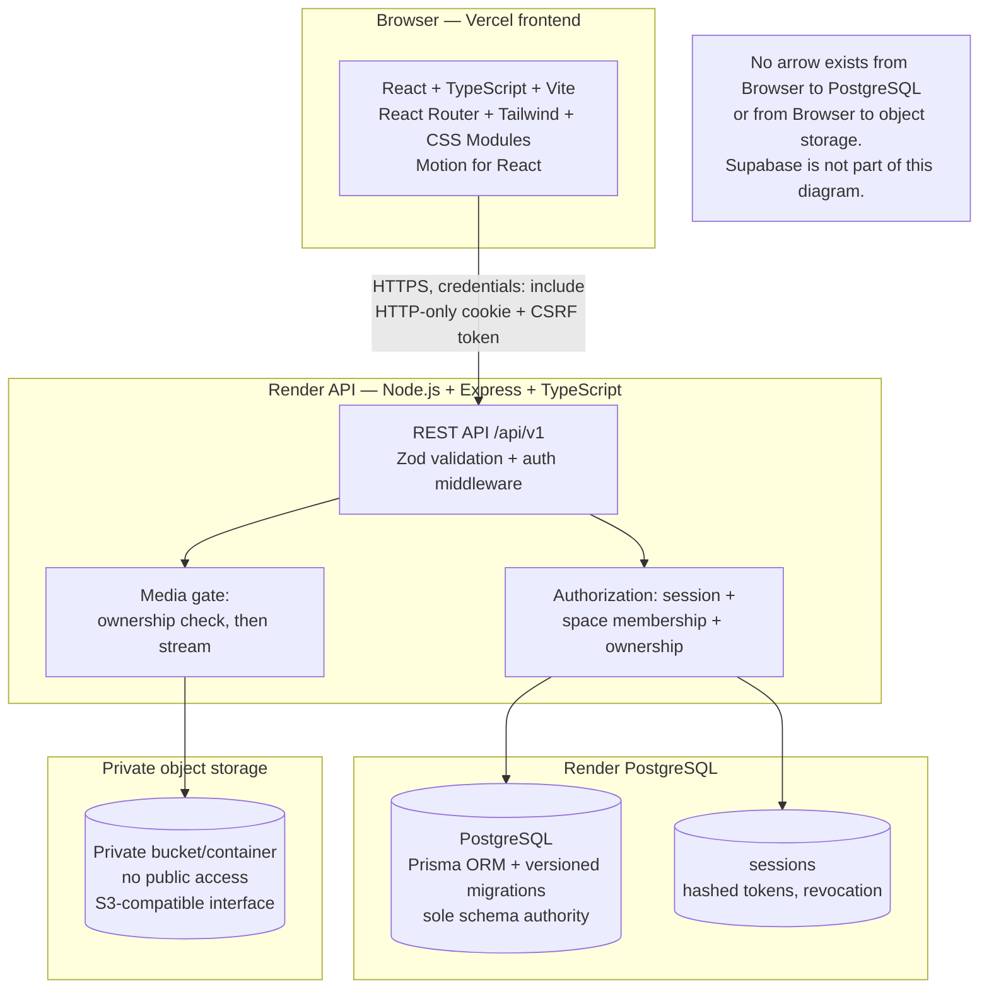

# A Little Place Called Us — Architecture and Security Specification

## Document status — read this first

- **Phase:** 0.3, specification only. This document is not application code.
- **Baseline verified before writing:** branch `main`, commit
  `8506670a2d7a5efb6282157112e9f96095c358e8`, tracked files only
  `.gitignore` and `ISOLATION-NOTE.md`, working tree clean, no remote.
- **What this document does:** defines the intended system so Phase 1 can be
  implemented and reviewed against it, and so security properties can be
  tested rather than assumed.
- **What this document does not do:** it does not create code, install
  dependencies, create a Prisma schema or migrations, configure hosting,
  connect to any live service, or migrate any existing data.
- **Existing Supabase:** must not be used for the new architecture. The old
  production Supabase project, if it still exists, is out of scope for this
  rebuild and must remain untouched until a separate, explicitly approved
  data decision is made. No migration from Supabase is specified here.
- **Language in this document:**
  - **APPROVED** means decided in the Phase 0.3 brief.
  - **PROPOSED** means a concrete default in this specification, open to
    review, but not yet a product decision where Section 9 flags it.
  - **UNVERIFIED** means no live check was performed in this documentation
    phase. Do not budget, purchase, or configure from an UNVERIFIED claim.
  - **REQUIRES APPROVAL** means Phase 1 must not silently decide it.

### Revision note — Phase 0.3 review corrections (documentation only)

This revision corrects the Phase 0.3 draft. It does not implement
anything, and it does not decide any item marked REQUIRES APPROVAL.
Where the draft contradicted itself, the corrected text below replaces
the earlier wording; the earlier wording must not be read as still
standing. In particular, this revision corrects: (A) PostgreSQL CHECK
limits and concurrency, (B) middleware/CSRF ordering, (C) cookie
deployment, (D) password-reset token handling, (E) media lifecycle and
referential integrity, (F) backup encryption and recovery, (G)
idempotency and related edge cases, and (H) phased implementation order.
Every new recommendation added by this revision is labelled PROPOSED
until approved. Unresolved decisions in Section 9 remain unresolved.

## Product in one paragraph

A private, romantic, interactive storybook for exactly two partners. Two
individual accounts share one space. Inside that space they keep memories,
letters, private journals, appreciations, future plans, reminders, and
light games. Nothing in the product measures affection, ranks the partners,
or gates an essential feature behind a game token or reward. Privacy is a
server-enforced property, not a UI convenience: if the API would return a
row, the browser must never have received it in the first place.

## 1. System architecture

### 1.1 Boundaries

The system has five trust boundaries, and no boundary may be bypassed by
another component:

1. **Browser (Vercel frontend).** Renders UI only. It holds no secret, no
   database credential, no storage credential, and no decision about who
   may read what. A frontend route guard is navigation only. It is never
   authorization.
2. **REST API (Render API service).** The only component that talks to
   PostgreSQL and to private object storage. Every private operation
   re-checks authentication, space membership, and ownership on the server,
   in the same request, before any row or byte is returned.
3. **PostgreSQL (Render PostgreSQL).** The only durable store for
   structured data. Prisma is the sole schema authority for the new
   application. No hand-written schema file, no second migration system,
   and no direct SQL from the browser may coexist with it in production.
4. **Session store (PostgreSQL, server-managed).** Sessions live in the
   database as hashed tokens (Section 4). The browser holds only an opaque
   token in an HTTP-only cookie. The browser JavaScript cannot read it.
5. **Private object storage.** The only store for uploaded media bytes.
   Buckets/containers are private by default. Media never has a public URL.
   The API is the gate: it checks ownership, then either streams bytes
   itself (the recommended v1 path, Section 5) or issues a short-lived
   signed link under strict conditions.

The frontend never calls PostgreSQL or object storage directly. The API
never trusts a `userId`, `spaceId`, or `authorId` supplied by the client
as proof of identity or membership. Identity comes from the validated
session; membership comes from a database lookup in that request.

### 1.2 Architecture diagram



### 1.3 Request flow (normative)

1. Browser sends a request to the API origin with credentials included.
   The HTTP-only session cookie travels automatically; a CSRF token travels
   as a header on state-changing requests (Section 4.4).
2. API validates Origin/Referer against the allowlist, validates the CSRF
   token where required, then resolves the session from its hash.
   Expired or revoked sessions stop here with a generic 401.
3. API loads the caller's membership for the target space, if any, in the
   same transaction or query predicate as the data lookup. A resource
   lookup that does not include membership is a defect, not an
   optimisation to fix later.
4. API validates input with Zod, applies the business rule, and runs the
   database transaction. PostgreSQL constraints are the backstop for
   races (Section 3.7), not a substitute for the application check.
5. API serialises only the fields the caller is allowed to see. For a
   scheduled letter that has not been delivered, the body field is absent
   or null for the non-author, and it is never sent and hidden by CSS.
   The same rule applies to private drafts and private journals: the rows
   are not returned at all to a non-author.
6. For media, the API checks ownership, then streams bytes or issues a
   short-lived link (Section 5). The browser never receives a storage
   credential and never guesses a storage key.

### 1.4 What is deliberately not in v1

- No real-time sockets, no push notifications, no email newsletters.
- No third-party analytics that would receive content, names, or media.
- No public sharing links, no public profiles, no search across spaces.
- No service-role or admin key in the frontend, and no admin API that can
  read another space's private content. Operational database access, if
  ever needed, is a separate, audited, human process outside the API.

## 2. Repository structure

### 2.1 Currently existing files — do not confuse with the proposal

At the Phase 0.3 baseline, the repository contains exactly:

- `.gitignore`
- `ISOLATION-NOTE.md`

Everything below is **PROPOSED** for Phase 1. None of it exists yet, and
creating it is not authorised by this document.

### 2.2 Proposed future tree

```
.                                  # repository root (PROPOSED, except the two files above)
├── docs/
│   └── architecture/
│       └── ARCHITECTURE-SPEC.md  # this file (the only Phase 0.3 deliverable)
├── apps/
│   ├── frontend/                 # React + TypeScript + Vite app (Vercel)
│   │   ├── src/
│   │   │   ├── main.tsx
│   │   │   ├── App.tsx           # router shell only; no auth decisions here
│   │   │   ├── routes/           # one route module per room/feature
│   │   │   ├── components/       # shared UI components
│   │   │   ├── rooms/            # Memories, Letters, Quiet, etc. (UI only)
│   │   │   ├── lib/
│   │   │   │   ├── api.ts        # fetch wrapper: credentials + CSRF + error envelope
│   │   │   │   └── session.ts    # session-state helpers (no token access)
│   │   │   └── styles/
│   │   │       ├── index.css     # Tailwind entry + shared tokens
│   │   │       └── *.module.css  # CSS Modules where a component needs scoping
│   │   ├── index.html
│   │   ├── vite.config.ts
│   │   ├── tsconfig.json
│   │   └── package.json
│   └── api/                      # Node.js + Express + TypeScript (Render)
│       ├── src/
│       │   ├── index.ts          # server bootstrap only; no business logic here
│       │   ├── config.ts         # env parsing + fail-fast on missing secrets
│       │   ├── app.ts            # middleware order: headers, CORS, session resolution, CSRF, syntactic validation, authorized lookup (see Section 4.8)
│       │   ├── db.ts             # Prisma client singleton
│       │   ├── errors.ts         # error envelope + safe error mapping
│       │   ├── auth/
│       │   │   ├── passwords.ts
│       │   │   ├── sessions.ts
│       │   │   ├── csrf.ts
│       │   │   └── rateLimit.ts  # PostgreSQL-backed limits (Section 4.6)
│       │   ├── middleware/
│       │   │   ├── requireAuth.ts
│       │   │   ├── requireSpaceMember.ts
│       │   │   └── validate.ts   # Zod wrapper
│       │   ├── routes/
│       │   │   ├── auth.ts
│       │   │   ├── spaces.ts
│       │   │   ├── invitations.ts
│       │   │   ├── memories.ts
│       │   │   ├── letters.ts
│       │   │   ├── journals.ts
│       │   │   ├── appreciations.ts
│       │   │   ├── plans.ts
│       │   │   ├── reminders.ts
│       │   │   ├── games.ts
│       │   │   ├── board.ts
│       │   │   └── media.ts
│       │   ├── services/
│       │   │   ├── spaces.ts     # membership transactions, two-member rule
│       │   │   ├── letters.ts    # delivery-condition logic (server only)
│       │   │   ├── media.ts      # storage client, EXIF strip, key building
│       │   │   ├── games.ts      # game-state validation (server only)
│       │   │   └── audit.ts      # security-event recording (no content)
│       │   └── validation/
│       │       └── schemas.ts    # re-exports shared Zod schemas (see packages/)
│       ├── prisma/
│       │   ├── schema.prisma     # SOLE schema authority (Phase 1 only)
│       │   └── migrations/       # versioned Prisma migrations (Phase 1 only)
│       ├── tsconfig.json
│       └── package.json
├── packages/
│   └── shared/                   # shared types + Zod schemas, no secrets, no Node APIs
│       ├── src/
│       │   ├── schemas.ts        # input shapes used by both frontend and API
│       │   └── types.ts
│       ├── tsconfig.json
│       └── package.json
├── tests/
│   ├── unit/                     # pure logic: delivery, masking, game validation
│   ├── api/                      # API integration tests against a test database
│   ├── security/                 # authorisation-failure and abuse-case tests
│   └── e2e/                      # browser end-to-end tests (Section 8)
├── .env.example                  # PROPOSED, Phase 1: placeholders only, no real values
└── package.json                  # PROPOSED, Phase 1: workspace root (npm workspaces)
```

### 2.3 Structure rules

- **Frontend never imports Prisma, database code, or storage credentials.**
  A frontend import of `prisma`, `pg`, or a storage SDK is a review failure.
- **API never trusts the frontend's copy of a rule.** A rule implemented
  only in `apps/frontend` is not implemented.
- **Shared package never contains secrets, URLs with credentials, or
  browser-only or Node-only code.** It contains types and Zod schemas only,
  so the same shape is validated on both sides.
- **Prisma migrations are the only schema change mechanism.** No
  application-boot schema creation, no `CREATE TABLE IF NOT EXISTS` in
  server code, and no manual production SQL outside a reviewed migration.
- **Tests live beside the behaviour they protect.** A new endpoint without
  its authorisation-failure test is incomplete, even if the happy path works.


## 3. Database and domain model

### 3.1 Principles

- **One space, two people, no exceptions in code.** The two-member limit
  and the one-space-per-user rule are enforced by database constraints
  *and* by a serialised application transaction (Section 3.7). Either
  layer alone is insufficient: constraints stop races, transactions give
  clear errors and keep related writes atomic.
- **Ownership is a column, not a comment.** Every content row carries
  `spaceId` and `authorId`. Every read predicate includes the space and,
  where the rule requires it, the author. A query that fetches by primary
  key alone and checks permission afterwards must not be merged.
- **Soft delete is the default; permanent delete is a second, explicit
  act.** No API endpoint may hard-delete a row that has not already been
  soft-deleted, except account/space lifecycle operations that are
  separately approved (Section 9).
- **Timestamps are server-generated.** `createdAt` and `updatedAt` come
  from the database (`now()` / Prisma `@default(now())` and
  `@updatedAt`), never from client input. Calendar dates (for example a
  memory's happened date or a plan's target date) are `DATE` columns, not
  timestamps, so timezones cannot shift them by a day.
- **No content in audit rows.** Audit events record who did what to which
  resource and whether it succeeded. They never record letter bodies,
  journal bodies, media bytes, passwords, tokens, or invite codes.

### 3.2 Entities, relationships, and key constraints

All IDs are UUIDs unless stated. All tables carry `id`, `createdAt`,
`updatedAt`. Content tables also carry `spaceId`, `authorId`,
`deletedAt` (nullable), and `isFavorite` where the product supports it.

| Entity | Key fields (PROPOSED) | Relationships and constraints |
|---|---|---|
| `User` | `email` (unique, case-insensitive via a lowercased unique index), `passwordHash`, `displayName`, `avatarKey` (preset key only, never a file path supplied by the client) | One user, at most one active space membership (see `SpaceMember`). Email uniqueness must be enforced case-insensitively; Prisma `@@unique` on the raw column alone is not enough without the lowercased index or a normalised stored email. |
| `Session` | `userId`, `tokenHash` (unique), `expiresAt`, `lastSeenAt`, `revokedAt` (nullable), `createdIpHash`, `userAgentHash` (hashes only, never raw IP/agent strings in the main row if retention policy forbids them) | Many sessions per user. One session row per login. Revocation is a row update, not cookie deletion alone. Expired rows are purged by a scheduled job, never by the browser. |
| `PasswordResetToken` | `userId`, `tokenHash` (unique), `expiresAt`, `usedAt` (nullable) | Single-use, short-lived (Section 4.2). One outstanding reset per user is the proposed default; a new request invalidates prior unused tokens in the same transaction. |
| `Space` | `name`, `inviteCodeHash` (see Section 3.6), `createdById` | Created by one user. A space exists only with its membership rows; creation and creator membership are one transaction. |
| `SpaceMember` | `spaceId`, `userId`, `role` (`owner` / `member`), `joinedAt` | `@@unique([spaceId, userId])` and `@@unique([userId])`. The second unique constraint is what enforces one-space-per-user while a membership row exists. Leaving a space deletes the row in a reviewed lifecycle operation (Section 9), after which the user may join another space. |
| `Invitation` | `spaceId`, `tokenHash` (unique), `expiresAt`, `usedAt` (nullable), `attemptCount`, `lockedUntil` (nullable), `createdById` | Belongs to one space. See Section 3.6 for why a short code alone is weak and why this table, rate limits, and expiry must travel together. |
| `Reminder` | `spaceId`, `authorId`, `text`, `kind` (`note` / `prompt`) | Shared to both members. Author may edit/delete; partner may favourite and soft-delete only under the shared-content rule in Section 3.5. No new kinds may be added without a migration. |
| `Memory` | `spaceId`, `authorId`, `title`, `caption`, `story`, `happenedOn` (DATE), `tags` (text array), `sourcePlanId` (nullable, unique — see Section 3.5) | Shared to both members. Media lives in `MediaAsset` rows linked to the memory, not as a bare path string on the memory row alone. |
| `MediaAsset` | `ownerId` (author), `memoryId` (nullable FK), `planId` (nullable FK, for plan-completion media), `voiceNoteId` (nullable FK), `status` (`pending` / `active` / `soft_deleted` — see Section 5.6), `storageKey`, `mimeType`, `byteSize`, `width`, `height` (nullable for audio), `originalFilename` (sanitised, metadata only) | One asset per upload. Exactly one of `memoryId`, `planId`, `voiceNoteId` must be non-null (CHECK in reviewed migration SQL, Section 3.8). No `spaceId` is stored on the asset; space and author are derived by joining to the linked item, so they cannot diverge. No polymorphic `linkedType`/`linkedId` pair is used (Section 5.8). `storageKey` never contains an email, display name, or original filename. Soft-deleting a linked item does not delete the asset row or its storage object; permanent deletion follows Section 5.6, where the asset row is deleted in the same transaction as the item and a durable deletion job (next row) survives it. |
| `MediaDeletionJob` | `assetId` (identifier only, not a foreign key — the asset row is deleted in the same transaction that creates the job), `storageKey`, `status` (`pending` / `retrying` / `failed` / `completed`), `attempts`, `nextAttemptAt` | Durable outbox for storage deletion (Section 5.6). The job, not a lingering asset row, is what survives permanent deletion and tracks retries/failure. |
| `Letter` | `spaceId`, `authorId`, `title`, `body`, `visibility` (`shared` / `private_draft` / `scheduled`), `revealAt` (nullable) | `scheduled` requires `revealAt` (database CHECK). `private_draft` is author-only on every operation. `shared` is visible to both members. Delivery logic is server-only (Section 3.5). |
| `JournalEntry` | `spaceId`, `authorId`, `title`, `body`, `mood` | Author-only on every operation, including list, search, and counts. Partner queries must not return a count, a title, or a existence signal for another author's journals. |
| `Appreciation` | `spaceId`, `authorId`, `text`, `kind` (`appreciation` / `achievement`), `forName` | Shared to both members. Kind is a closed enum in the database, not free text. |
| `FuturePlan` | `spaceId`, `authorId`, `title`, `detail`, `category`, `status` (`planned` / `done`), `targetDate` (DATE, nullable), `completedAt` (nullable), `completionMediaId` (nullable) | `done` requires `completedAt`. Completion and optional linked-memory creation are one transaction (Section 3.5). No `in_progress` status exists unless a migration adds it and the product approves it. |
| `VoiceNote` | `spaceId`, `authorId`, `title`, `durationSec`, `mediaAssetId`, `room` (where the note was recorded, if the product keeps it) | Voice bytes live only as a `MediaAsset`. The voice row without its asset is incomplete and must not be served as playable. |
| `GameSession` / `GameProgress` / `GameRound` | `spaceId`, `playerId`, `gameKey`, `config` (JSON, server-validated), `state` (JSON, server-validated), `score` / `progress` counters | Game state is validated on the server on every write (Section 3.5 and Section 8). Client-supplied scores are never trusted as final; the server recomputes or bounds what it accepts. |
| `BoardGame` / `BoardMove` | `BoardGame`: `spaceId`, `version` (integer, 0 at creation, meaning zero moves have been accepted), `config` (JSON object), `state` (JSON object), `currentTurnUserId`, `status` (`active` / `finished`). `BoardMove`: `gameId`, `version` (integer, 1 for the first accepted move, then 2, 3, …), `actorId`, `move` (JSON, server-validated) | A game is created at version 0 with no moves. Each accepted move, in one transaction, inserts a `BoardMove` whose version is exactly the game's current version + 1 and updates the game's version to that value (Section 3.10). A finished game accepts no moves. A CHECK cannot enforce this cross-row rule (Section 3.8); it is enforced by a row lock on the game, the unique `(gameId, version)` constraint on moves, and server game validation. |
| `AuditEvent` | `actorId` (nullable for anonymous attempts), `action`, `resourceType`, `resourceId`, `spaceId` (nullable), `outcome` (`success` / `denied` / `failed`), `createdAt`, `ipHash`, `userAgentHash` | Append-only in application logic. No update or delete API for audit rows. Retention is a REQUIRES APPROVAL decision (Section 9). Audit rows contain no content bodies. |
| `RateLimitBucket` | `key` (e.g. `login:ip:<hash>`), `windowStart`, `count` | Backing store for Section 4.6. Keys use hashes of IPs, never raw IPs, where retention policy requires it. |
| `IdempotencyKey` | `userId`, `key` (client-supplied, scoped to user), `requestHash` (hash of the canonical request payload, not the payload itself), `resourceType`, `resourceId` (nullable until the first execution succeeds), `responseStatus`, `expiresAt` | Prevents duplicate creates on retry (Section 6.5). Keys expire (proposed 24 hours) and are never reused across users. No response body is stored in this row; a replay re-reads the original resource through the normal authorization predicate (Section 6.5). |

### 3.3 Indexes (PROPOSED minimum)

- `User`: unique lowercased email index.
- `Session`: index on `userId`, unique `tokenHash`, index on `expiresAt`
  for purging.
- `SpaceMember`: unique `(spaceId, userId)`, unique `(userId)`, index on
  `spaceId` for member listing.
- `Invitation`: unique `tokenHash`, index on `(spaceId, expiresAt)`.
- Every content table: index on `(spaceId, createdAt DESC)` and on
  `(spaceId, authorId)` where author-only queries exist, plus a partial
  index excluding soft-deleted rows where the query pattern justifies it.
  Prisma indexes must be reviewed against real query plans in Phase 1;
  an index list in a specification is not proof of performance.
- `MediaAsset`: indexes on `memoryId`, `planId`, and `voiceNoteId`
  (each where non-null), plus partial unique indexes enforcing at most
  one `active` asset per linked item (for example unique `memoryId`
  where `status = 'active'`, and the same for `planId` and
  `voiceNoteId`). Space lookup for an asset is via its linked item,
  not via a stored `spaceId` on the asset.
- `BoardMove`: unique `(gameId, version)` so two moves can never share a
  version, even under race.
- `FuturePlan`: index on `(spaceId, status, targetDate)` for the
  planned/done trail ordering (dated first, undated last, in application
  ordering logic, not by relying on database null ordering alone).

### 3.4 Ownership and visibility matrix (normative)

| Resource | Author can | Partner (other member) can | Non-member / anonymous can |
|---|---|---|---|
| Shared reminder, memory, appreciation, planned/done plan | Create, read, edit own, soft-delete own, restore own, favourite | Read, favourite; edit/delete only if the shared-content rule in Section 3.5 explicitly allows it for that type, otherwise read-only | Nothing, not even existence |
| Private journal | All operations on own rows only | Nothing: no row, no title, no count, no existence signal | Nothing |
| Private draft letter | All operations on own rows only | Nothing, as for journals | Nothing |
| Scheduled letter, before `revealAt` | All operations on own rows | See envelope metadata only (title, author, reveal time) if the product keeps envelope visibility; never the body | Nothing |
| Scheduled letter, at/after `revealAt` | As shared | Read body as shared | Nothing |
| Shared letter | As shared | Read body as shared | Nothing |
| Media asset | Upload, view own, delete own (via its linked item) | View only if linked item is visible to them under the rules above, and they are a space member | Nothing, including via a guessed storage key or URL |
| Game / board state | Play own turns, read shared state | Read shared state, play own turns when it is their turn | Nothing |
| Space / membership list | Read own space and its two members | Same (both members see each other) | Nothing |

If a future product change wants partner editing of another author's
shared item, it must be specified per type, with an audit event, and with
a test. The default in this specification is: partner is read-only for
another author's content, except favouriting and shared game/board play,
where the game itself is the shared object.

### 3.5 Deletion, delivery, and completion semantics

**Soft deletion (all content types).**

- Soft delete sets `deletedAt` to now. It does not delete the row, its
  media asset row, or its storage bytes.
- Every list, search, count, random-pick, and feed query excludes
  `deletedAt IS NOT NULL` rows by default. A query that forgets this
  predicate is a defect.
- A soft-deleted item lives in a Deleted view for its author (and, for
  shared items, under the shared-content rule for that type). Restore
  sets `deletedAt` to null. Restore is author-only for private items.
- **Partner-visible behaviour on soft delete and restore (correction,
  normative).** When a shared item is soft-deleted by its author, it
  disappears immediately from the partner's lists, feeds, random picks,
  and counts, and a direct request for it by the partner returns a
  generic 404, indistinguishable from non-existent — the partner is
  not told “this item was deleted by your partner”, because that
  itself is a disclosure about the author's action. The partner's
  media access to that item ends at the same moment (Section 5.6).
  When the author restores the item, it reappears for the partner
  under the normal shared rules, with its media restored to `active`
  without re-upload (bytes were retained during soft delete). No
  notification, badge, or “restored” marker is specified here; whether
  the partner is told about a deletion or restoration at all is a
  product decision in Section 9, and the default in this specification
  is silent disappearance/reappearance, not a deletion notice.
- **Restore window: PROPOSED 30 days, REQUIRES APPROVAL.** After the
  window, a scheduled job may offer permanent deletion or retain the row
  under a separate retention decision. Do not silently hard-delete after
  30 days without that approval.

**Permanent deletion (second, explicit act).**

- Permanent delete is refused unless the row is already soft-deleted.
- Permanent delete removes the database row in a transaction and creates
  a media-deletion job (Section 5.6) for each linked asset. Storage
  deletion failure must not silently resurrect the row, and must not
  leave a playable link: the asset row is marked for deletion and the
  media gate refuses it from that point, even if the storage object is
  still being removed.
- Permanent deletion of a space or account is not specified here. It is
  a Section 9 decision, because it determines what the remaining partner
  keeps, what is erased, and what audit trail remains.

**Scheduled letters.**

- Delivery condition is purely server time: `visibility = 'scheduled'`
  AND `revealAt IS NOT NULL` AND `now() >= revealAt`. No client clock,
  no client flag, no “mark as revealed” endpoint may deliver early.
- Before delivery, the API serialiser must not include the body for a
  non-author. Envelope metadata (title, author display name, reveal time)
  may be included only if the product decision in Section 9 confirms
  envelope visibility. If that decision is “no envelope”, then even the
  title is hidden from the partner until delivery.
- After delivery, the letter behaves as shared. Delivery does not change
  `visibility` in the database unless a migration defines a
  `deliveredAt` field; the time comparison alone is the source of truth,
  which avoids a background job that could fail to run.

**Future-plan completion without duplicates.**

- Completing a plan and creating its linked memory, if requested, happen
  in one database transaction.
- `Memory.sourcePlanId` is unique (nullable). A second completion
  attempt for the same plan cannot create a second memory, even under
  retry: the transaction, the unique constraint, and the idempotency key
  (Section 6.5) all point the same way.
- If completion is requested without a memory, no memory row is created
  and no empty placeholder memory is invented.
- Un-completing a plan (if the product ever allows it) must not delete
  the already-created memory. That behaviour REQUIRES APPROVAL and is
  not assumed here.

**Game tokens and rewards.**

- Game scores, tokens, coins, stars, or any similar counter are cosmetic
  integers only. They never unlock, lock, rank, or gate access to
  memories, letters, journals, plans, reminders, or any essential feature.
- They are never displayed as a relationship score, affection score, or
  comparison between partners. If a game screen ever shows a counter,
  its label must make clear it is game-only.
- Server validation bounds every counter. A client may not set an
  arbitrary score, and a score may not be used to prove anything about
  the other partner.

### 3.6 Invitations and the two-member limit

- A space is created and its creator joins in one transaction. A space
  with zero members must not persist as a joinable object.
- Joining requires: a valid, unexpired, unused (or not-yet-consumed)
  invitation for that space, a session for a user with no existing space
  membership, and a membership count below two at commit time.
- **Short invite codes are weak.** A 6-character code has limited
  entropy. Keeping a 6-character UX is acceptable only together with:
  short expiry (PROPOSED 7 days), a per-space attempt counter with
  lockout (PROPOSED 5 failed attempts, then lock until expiry or manual
  rotation — REQUIRES APPROVAL for exact numbers), generic failure
  messages that do not reveal whether a code exists, and code rotation
  after a successful join or after lockout. If product approval prefers
  stronger security over short-code UX, the specification alternative is
  a longer single-use invitation link/token (at least 128 bits of
  entropy, hashed at rest). Phase 1 must not keep short codes *and*
  drop the rate limits. That combination is a defect.
- Invitation codes/tokens are stored hashed, never in plaintext, and
  never logged. Lookup is by hash. Comparison must be constant-time
  where the implementation uses direct comparison.
- An invitation attempt that fails must record an audit event with
  outcome `denied` or `failed`, without recording the attempted code.

### 3.7 How PostgreSQL and transactions enforce critical rules

| Rule | Database enforcement | Application transaction enforcement |
|---|---|---|
| At most two members | CORRECTION: a CHECK constraint cannot enforce this rule, because a CHECK is row-local and cannot count other rows (Section 3.8). Enforcement is: (1) the primary mechanism, a transaction that locks the parent `Space` row, re-counts members, and only then inserts; plus (2) a defence-in-depth trigger that itself locks the parent space row before counting (Section 3.9). A trigger without a parent-row lock does not prevent concurrent joins and must not be relied on alone. Unique constraints in Section 3.2 do not enforce the count. The test in Section 8 must prove concurrent joins cannot create a third member. | Join runs in a transaction that locks the space row (`SELECT … FOR UPDATE` on the `Space` row, held until commit), re-counts members, checks the caller's existing membership, checks invitation validity, then inserts membership and marks the invitation consumed, all in the same transaction. Failure returns a generic, safe error, not a constraint leak. |
| One space per user | Unique index on `SpaceMember.userId`. | Create/join checks existing membership before insert and handles the unique violation as “already in a space”, without revealing which space. |
| Scheduled letter requires a reveal time | CHECK: `visibility <> 'scheduled' OR revealAt IS NOT NULL`. | Zod validation mirrors the CHECK, but the CHECK is authoritative. |
| Plan `done` requires completion time | Row-local CHECK in reviewed migration SQL: `status <> 'done' OR completedAt IS NOT NULL`. This CHECK is valid because it refers only to columns of the same row (Section 3.8). It does not, by itself, prove the completion transaction ran; the transaction in the next column is still required. | Completion transaction sets both fields together, or rejects. |
| Board version advances by exactly 1 | CORRECTION: a CHECK cannot enforce a cross-row version rule (Section 3.8). Enforcement is: unique `(gameId, version)` on moves, a row-local CHECK that `BoardGame.version >= 0` and that `state`/`config` are JSON objects (row-local only), plus a transaction that locks the game row (Section 3.10). A trigger is a backstop only if it also locks the game row; it is not the primary mechanism. | Move handler, in one transaction: locks the `BoardGame` row (`SELECT … FOR UPDATE`), re-reads version, turn, and status, rejects if finished or not the caller's turn, validates the move against server game rules, inserts a `BoardMove` with version = current + 1, and updates the game version, state, and turn together. A forged move with a correct version number but an illegal game step is still rejected by server game validation (Section 8). Concurrent moves serialise on the game-row lock; the loser re-reads fresh state and must be re-validated, never blindly applied. |
| No duplicate memory per plan | Unique nullable `Memory.sourcePlanId`. | Completion transaction + idempotency key (Section 6.5). |
| Author-only journals/drafts | No database row-level policy is assumed in this architecture, because the API is the only database client. Author-only access is enforced by query predicates (`authorId = caller`) on every journal/draft query, plus tests that prove partner queries return zero rows. If a future direct-database client is ever added, row-level security must be re-specified from scratch; it is not inherited from this document. | Every journal/draft handler includes the author predicate. List endpoints for journals never accept a partner's author filter as a way to read another author's rows. |

**Transaction boundaries (normative).** Each of the following is one
transaction or it is incomplete: space creation + creator membership;
join + invitation consumption + membership insert; plan completion +
linked-memory creation; board move + version advance + turn change;
media upload record + linked-item update (storage upload itself is
outside the database transaction — see Section 5.4 for the orphan
handling that follows from this); password change + session revocation
(except the new session, where applicable); permanent delete +
media-deletion job creation.

### 3.8 What PostgreSQL CHECK constraints can and cannot do — correction

A PostgreSQL `CHECK` constraint is evaluated on a single row, using only
that row's columns (and immutable functions of them). It cannot count
other rows, cannot see uncommitted rows from concurrent transactions,
and cannot enforce a rule that depends on the state of another table.
Consequences, normative for this project:

- **A CHECK cannot enforce “at most two members”.** Counting
  `SpaceMember` rows for a space is a cross-row rule. Any earlier draft
  wording suggesting a CHECK could do this is corrected here and must
  not be implemented.
- **A CHECK cannot enforce “board version advances by exactly 1”.**
  Comparing a new move's version to the game's current version, or to
  other moves, is a cross-row rule. A CHECK can only enforce row-local
  facts, for example `BoardGame.version >= 0`, or that a JSON column
  holds an object.
- **A CHECK can enforce row-local rules**, for example:
  `visibility <> 'scheduled' OR revealAt IS NOT NULL`, and
  `status <> 'done' OR completedAt IS NOT NULL`. These are valid CHECKs
  because they refer only to the row being written.
- **Prisma Schema Language versus migration SQL (PROPOSED, to be
  confirmed in Phase 1 against the Prisma version actually used).**
  Prisma Schema Language directly expresses: primary keys, foreign
  keys, unique constraints and indexes, defaults, and enums. It does
  not, on its own, guarantee cross-row rules, triggers, partial unique
  indexes, advisory locks, or complex row-local CHECKs. Those belong in
  reviewed SQL inside Prisma migrations, with a comment in
  `schema.prisma` pointing to the migration that implements them, and
  with a test proving the rule. Phase 1 must not assume Prisma
  generates a trigger, a partial index, or a CHECK unless the generated
  migration is inspected and shows it. No production database may be
  altered by hand outside a reviewed migration, even to “just add a
  trigger”.

### 3.9 Serialized transactions and triggers — how concurrency is actually prevented

Under PostgreSQL's default `READ COMMITTED` isolation, two concurrent
transactions do not see each other's uncommitted inserts. That is why
“count, then insert” without a lock is unsafe, and why a trigger that
merely counts is also unsafe: two concurrent joins can both count one
existing member, both pass, and both insert, producing three members.

The normative pattern for every cross-row limit in this project
(membership count, invitation consumption, board version) is:

1. Begin a transaction.
2. Lock the parent row first, and hold the lock until commit:
   `SELECT … FOR UPDATE` on the `Space` row for joins, on the
   `BoardGame` row for moves, on the `Invitation` row for consumption.
   The lock serialises concurrent writers for that parent; readers are
   not blocked, writers queue.
3. Re-read the current state inside the locked transaction (member
   count, invitation status, game version/turn/status). Never trust a
   count or version read before the lock.
4. Validate, then write all related rows in the same transaction.
   If any check fails, roll back the whole transaction and return a
   generic error.
5. On serialization or lock errors, the API may retry the whole
   transaction a bounded number of times (PROPOSED maximum 3 attempts,
   with backoff), re-reading fresh state each time. A retry must never
   blindly re-apply a move or a join that already succeeded; it must
   re-validate from the locked, current state.

**When a trigger is appropriate.** A trigger is appropriate only as a
defence-in-depth backstop, never as the sole enforcement, and only if
it provides the same locking guarantee: the trigger function must lock
the parent row (for example by `SELECT … FOR UPDATE` on the parent
space/game row, or by taking a transaction-scoped advisory lock keyed
by the parent ID) before counting or comparing, and must raise an
exception on violation. A trigger that counts without locking, a
trigger that relies on a unique constraint alone to enforce a count,
and a trigger that can be bypassed by a direct write path that does
not fire it, are all insufficient. Triggers, where used, live in
reviewed Prisma migrations (Section 3.8), are tested with concurrent
transactions in Section 8, and are documented alongside the application
transaction they backstop — they do not replace it.

**What is not sufficient, on its own:** a unique constraint (it
prevents duplicates, not counts), an application count without a lock,
a trigger without a lock, `SERIALIZABLE` isolation without a retry
strategy, and any frontend check.

### 3.10 Board-game initial version and first-move semantics — correction

- **Creation:** a `BoardGame` is created with `version = 0`,
  `status = 'active'`, an initial `state` object, an initial `config`
  object, and `currentTurnUserId` set to the player who moves first.
  Version 0 means “zero moves have been accepted”. There is no
  `BoardMove` with version 0.
- **First move:** the first accepted move inserts a `BoardMove` with
  `version = 1` and, in the same transaction, updates the game to
  `version = 1`, advances `currentTurnUserId` to the other member, and
  updates `state`. The second accepted move uses version 2, and so on.
- **Concurrency:** two concurrent first moves both attempt to lock the
  same `BoardGame` row. One wins, inserts version 1, and commits. The
  other blocks on the lock, then re-reads version 1, turn, and status,
  and must be re-validated as a move for version 2 (including turn
  ownership). If it is not the new turn-holder's move, or if its move
  was computed against the version-0 board and is no longer legal, it
  is rejected with a safe conflict error and the client must re-fetch
  the board. It must never be inserted as a second version-1 move: the
  unique `(gameId, version)` constraint is the final backstop, and a
  unique-violation on retry is treated as a conflict, not as a silent
  success.
- **Finished games:** once `status = 'finished'`, the move transaction
  rejects before any insert, even if the version number would otherwise
  be correct. Finishing a game and accepting a move are mutually
  exclusive in the same transaction: the finish operation also locks
  the game row.
- **State shape:** `config` and `state` must remain JSON objects at
  every version. A move that would replace either with a non-object
  (array, string, null) is rejected by server validation and by a
  row-local CHECK where the migration implements one. The game engine
  itself lives on the server; the client never supplies a final state
  that the server stores unchecked.


## 4. Authentication and application security

### 4.1 Identity and passwords

- **Accounts are individual.** Each partner has their own email and
  password. There is no shared account, no shared password, and no
  “partner password” that grants access to another person's private rows.
- **Password hashing: Argon2id is the PROPOSED default.** Parameters
  must be taken from current OWASP guidance at implementation time and
  recorded in code review, not copied from memory in this document.
  If Argon2id cannot build reliably on the Render runtime, the fallback
  is bcrypt with cost 12, recorded as a deliberate, reviewed downgrade
  with a plan to return to Argon2id. Plaintext, MD5, SHA-1, or unsalted
  hashes are prohibited. Passwords are never logged, never stored in
  audit rows, and never returned by any API.
- **Password rules (PROPOSED, REQUIRES APPROVAL for exact numbers):**
  minimum 10 characters, no maximum that truncates silently (accept at
  least 128 characters, hash the full input), no forced character-class
  puzzle, no periodic expiry. Rate limiting (Section 4.6) and breach
  guidance are the controls, not complexity theatre. A password-strength
  meter, if shown, is guidance only and must not block a long passphrase.
- **Display names and avatar keys** are user-controlled profile fields,
  validated as short text / closed enum respectively. An avatar key is
  a preset identifier (for example `bunny`, `fox`), never a client-supplied
  file path, URL, or storage key.

### 4.2 Password reset

1. User submits an email on the reset form. The API always returns the
   same success message, whether or not the email exists, and whether or
   not an account is already in a space. This prevents user enumeration
   (Section 4.7).
2. If the email exists, the API creates a single-use reset token, stores
   only its hash, sets a short expiry (PROPOSED 1 hour), and invalidates
   prior unused reset tokens for that user in the same transaction.
3. **CORRECTION — fragment handoff, not a query-string token.** The
   reset link goes to the frontend origin only, over HTTPS, and carries
   the token in the URL fragment, never in the query string — for
   example `https://FRONTEND_ORIGIN/reset#token=<token>` (placeholder
   origin; the real origin is the approved frontend origin only).
   The fragment is never sent to the server in an HTTP request, so it
   cannot appear in server, proxy, or hosting logs the way a query
   string can, and browsers strip the fragment from the `Referer`
   header, so it is not leaked to third-party resources loaded by the
   page. The frontend, on loading the reset page, must: (a) read the
   fragment token into memory only (never `localStorage`,
   never `sessionStorage`, never a URL that is then navigated to);
   (b) immediately remove it from the address bar with
   `history.replaceState` (so the token does not remain in the
   visible URL or in the history entry after replacement); (c) POST
   it in the request body (never in a URL, never in a query string,
   never in a log line) to the reset-confirm endpoint, together with
   the new password and the applicable CSRF/Origin checks for that
   endpoint; and (d) clear it from memory on success, failure, or
   page unload. The reset page itself must load no third-party scripts,
   no analytics, no third-party fonts, and no external resources of
   any kind, and must be served with a strict Content-Security-Policy
   that blocks them, because any third-party script on that page could
   read the fragment before it is removed. The token is never logged,
   never stored in analytics, and never sent to any other origin.
   **Risks of the old query-string approach, corrected here:** query
   strings are commonly written to server and proxy logs, retained in
   browser history, sent in `Referer` headers to third parties when the
   page loads external resources, and visible in shoulder-surfing and
   screenshots. A reset token in a query string therefore survives
   longer and in more places than the token's intended lifetime, even
   after single-use invalidation, because a logged copy can be replayed
   within its expiry window if it was captured before use. The fragment
   approach does not eliminate all risk — the initial link itself, if
   forwarded or pasted elsewhere, still contains the token until it is
   removed, and email itself is not a secure channel — but it removes
   the server-log, proxy-log, and referrer exposures that query strings
   create, which is why it is required here.
4. On use, the API receives the token only in the POST body from the
   fragment handoff in step 3 (never from a query string), checks hash,
   expiry, and unused status in one step, then in one transaction:
   updates the password hash, marks the token used, and revokes all
   existing sessions for that user (Section 4.3).
   The user must sign in again with the new password. A reset token
   cannot be reused after success or after expiry.
5. **Email provider: UNRESOLVED.** The approved stack does not include
   an email service. Options (for example Resend, SendGrid, AWS SES)
   are UNVERIFIED in this phase for pricing, deliverability, domain
   verification, and Render compatibility. No provider is chosen here.
   Phase 1 must not start password reset until the provider, sender
   domain, and abuse handling are approved, because a reset flow without
   a trusted sender is not a reset flow at all.
6. Rate limit: PROPOSED 3 reset requests per account per hour and a
   per-IP limit (Section 4.6). Repeated requests for the same email
   must not reveal, via timing or message, whether the email exists.

### 4.3 Sessions: creation, rotation, expiration, revocation, logout

- **Server-managed sessions (APPROVED).** On successful login, the API
  generates a cryptographically random token (at least 256 bits from
  the runtime CSPRNG), stores only its SHA-256 hash in the `Session`
  row, and sets it in an HTTP-only cookie. The raw token exists only in
  the Set-Cookie header and in server memory during that response. It
  is never stored in `localStorage`, never placed in a URL, and never
  returned in a JSON body.
- **Cookie attributes (APPROVED for production):** `HttpOnly`,
  `Secure`, `Path=/` (or a narrower API path if the deployment uses
  one), and `SameSite` as decided in Section 4.4. `Max-Age` matches the
  session lifetime. **Default: host-only cookie, no `Domain`
  attribute.** A cookie set by the API origin without a `Domain`
  attribute is sent only to that exact host, which is the narrowest
  scope and the default in this specification. A parent-domain
  `Domain=.example.com` cookie is not necessary for sibling subdomains
  and must not be set by default (see Section 4.4 correction).
- **Lifetime (PROPOSED, REQUIRES APPROVAL):** absolute expiry 30 days,
  idle expiry 7 days (updated on authenticated activity via
  `lastSeenAt`). A session past either limit is invalid, even if the
  cookie has not expired in the browser.
- **Rotation:** a new token is issued on login and on password change.
  The old session row is revoked in the same transaction as the new
  session is created, so a stolen old token cannot survive a legitimate
  password change. Periodic rotation on every request is not required
  and would break legitimate multi-tab use; rotation on privilege
  change is required.
- **Logout:** logout revokes the current session row and clears the
  cookie with an expired Set-Cookie for the same attributes. Logout is
  not “delete the cookie in JavaScript” — JavaScript cannot delete an
  HTTP-only cookie, and the server row must be revoked or logout is
  theatre.
- **Logout everywhere:** a separate endpoint revokes all sessions for
  the caller. It is offered in Settings and after password reset
  (where it is automatic, Section 4.2).
- **Session lookup:** every authenticated request hashes the presented
  token, looks up the session row, and checks `revokedAt IS NULL` and
  `expiresAt > now()` and idle expiry. A missing, expired, or revoked
  session returns a generic 401 with no hint about which condition
  failed, and no user data.

### 4.4 Cookies, CSRF, and the cross-origin problem — do not gloss over this

**Cookies alone do not prevent CSRF. Frontend route guards do not
provide authorization. Both statements are normative for this project.**

The frontend (Vercel) and API (Render) are, by default, different
origins. That fact decides the cookie strategy, and Phase 1 must implement
exactly one of the approved options below, not improvise a third:

- **Option A — CORRECTION, REQUIRES APPROVAL for domains:** use custom
  domains that are sibling subdomains of the same registrable domain
  (for example `app.example.com` for the frontend and
  `api.example.com` for the API). **A parent-domain cookie is not
  necessary for this option, and must not be assumed.** Sibling
  subdomains share the same site (same eTLD+1), even though they are
  different origins. A host-only cookie set by `api.example.com`
  (no `Domain` attribute, `HttpOnly`, `Secure`, `SameSite=Lax`) is
  sent by the browser to `api.example.com` on same-site fetches from
  `app.example.com`, including state-changing fetches, because the
  request is same-site. A `Domain=.example.com` cookie would instead
  be sent to *every* subdomain, widening exposure for no v1 benefit,
  and is therefore prohibited as the default. It would be justified
  only if a future need required the same cookie to be readable across
  multiple API subdomains, which v1 does not have, and only with
  explicit approval. CSRF defence still requires a token (below), and
  `SameSite=Lax` remains defence in depth, not the sole control. This
  option requires domain ownership, DNS, and TLS decisions that are
  not in this document.
- **Option B — RECOMMENDED if custom domains are not approved:** proxy
  API requests through the frontend origin (for example Vercel rewrites
  from `/api/*` to the Render API). The browser then sees a single
  origin, a host-only cookie for the frontend origin with
  `SameSite=Lax` works, and the API still validates Origin. The proxy
  must not strip authentication or CSRF headers, must preserve the
  API's security headers, and must not cache authenticated responses.
  Proxy trade-offs that must be verified in Phase 1 (UNVERIFIED here):
  Vercel rewrite/function limits on request/response size, timeout,
  and streaming (which affect media proxying and large uploads),
  client-IP attribution for rate limiting (the API will see the proxy
  IP unless a trusted forwarded-for header from Vercel only is used,
  and that header must never be trusted from the open internet), and
  cache-poisoning risk if any authenticated response is ever cached.
  If media streaming through the proxy proves unsuitable, media may
  need a direct API origin path, which reopens the Option A decision
  for media specifically — that split must be specified, not improvised.
- **Option C — FALLBACK ONLY, REQUIRES EXPLICIT APPROVAL:** if neither
  A nor B is used, the cookie must be `SameSite=None; Secure` to travel
  cross-site at all. This is the weakest of the three for CSRF exposure
  and requires the strictest CSRF and Origin controls below. Do not
  default to Option C because it is easiest to configure.

**CSRF mitigation (all options, defence in depth):**

- Every state-changing request (`POST`, `PUT`, `PATCH`, `DELETE`) must
  carry a CSRF token in a header (for example `X-CSRF-Token`) that the
  server validates against a server-stored or cryptographically bound
  value tied to the session. The CSRF token itself is not HTTP-only; it
  is fetched from a dedicated endpoint or embedded by the API response
  in a way that a cross-site attacker cannot read it (same-origin policy
  is what protects it, not secrecy from the legitimate browser).
- The API validates `Origin` and, where present, `Referer` against the
  allowlist for state-changing requests, and rejects requests with a
  missing or non-allowlisted Origin where the client is expected to send
  one. A missing Origin from a browser fetch is suspicious, not neutral.
- `SameSite` is a mitigation, never the sole CSRF control, even under
  Option A or B.

**Comparison — Option A (sibling custom domains, host-only cookie) versus
Option B (same-origin Vercel proxy) — PROPOSED analysis, final choice
REQUIRES APPROVAL and remains unapproved in this document.**

| Dimension | Option A: sibling subdomains, host-only API cookie | Option B: Vercel proxy, single origin |
|---|---|---|
| Cookie scope | Narrow: API host only, no `Domain` attribute. Not sent to other subdomains. | Narrow: frontend origin only, via proxy. API origin cookie is never set directly in the browser. |
| `SameSite` behaviour | Same-site (shared eTLD+1) fetches include a `Lax` cookie, including POST fetches. Cross-site (different registrable domain) would not. | Single origin, so `Lax` works for all fetches. No cross-site cookie rule is triggered. |
| CSRF exposure | Lower than `None`, but still requires session-bound token + Origin checks. A malicious sibling subdomain, if ever created, is same-site — hence the host-only (not parent-domain) default matters. | Lower surface for cookie theft via other subdomains, but proxy itself becomes a trust boundary: a proxy misconfiguration can strip headers or cache authenticated responses. |
| Setup | Requires domain, DNS, TLS for both hosts, and CORS allowlist for the frontend origin. More upfront work, fewer runtime surprises for media. | No custom domain needed initially. Faster to start, but rewrite limits, timeouts, streaming, and IP attribution must be verified (UNVERIFIED here). |
| Media / uploads | Direct API path, no proxy size/timeout limits. Preferred if media proxying is heavy. | Media flows through the proxy; large uploads and Range streaming must be proven, not assumed. |
| Failure mode if misconfigured | Cookie not sent (login appears broken) or CORS rejection — visible, fail-closed if Origin checks are strict. | Cached authenticated response or stripped header — potentially silent and privacy-relevant. Cache headers must be tested explicitly. |

**Required browser-level tests for the actual deployment origins
(normative, not localhost-only).** Localhost tests prove logic; they do
not prove the deployment cookie model, because localhost is treated
specially by browsers for `Secure` and same-site rules. Before launch,
the following must pass in a real browser against the real staging
frontend and API origins (with test data only):

1. Login sets a cookie with exactly the approved attributes:
   `HttpOnly`, `Secure` (production), `SameSite` as approved, no
   `Domain` attribute unless a parent-domain cookie was explicitly
   approved, and `Path` as approved. Attributes are inspected in the
   browser, not inferred from server code.
2. A subsequent authenticated fetch from the frontend origin to the
   API origin includes the cookie, and an authenticated state-changing
   fetch with a valid CSRF token succeeds.
3. The same fetch without a CSRF token, and with a token from another
   session, fails (Section 8, T18).
4. The cookie is not sent to an unrelated subdomain or to a different
   registrable domain, and a request from an unlisted origin with
   credentials is rejected (Section 8, T19).
5. Logout clears the cookie (expired Set-Cookie with identical
   attributes) and the old session token no longer works.
6. Under Option B only: an authenticated response is never served from
   proxy cache to a second user/session, and media Range requests work
   through the proxy.
7. Under Option A only: a fetch from the frontend subdomain to the API
   subdomain includes the host-only cookie, and no parent-domain cookie
   is present.

**Final deployment choice: UNAPPROVED.** Options A, B, and C are all
described here, with A or B preferred over C, but none is selected by
this document. Phase 1 must not proceed on a cookie model until the
user explicitly chooses A, B, or C, including the domain/proxy
consequences listed above.

### 4.5 CORS allowlist

- **Production CORS is an allowlist, not a reflection.** The API
  allows exactly the approved frontend origin(s), with
  `Access-Control-Allow-Credentials: true`, a closed method list
  (`GET`, `POST`, `PUT`, `PATCH`, `DELETE`, `OPTIONS` only where needed),
  and a closed header list (including the CSRF header and
  `Content-Type`). `Access-Control-Allow-Origin: *` with credentials is
  prohibited and must fail review.
- **Placeholders, not real origins, in this document.** Production
  origins are written as `FRONTEND_ORIGIN` and, for previews, as an
  explicitly approved preview-origin pattern, if previews are ever
  allowed to call production APIs at all. The recommended default is:
  previews do **not** call the production API. A preview frontend that
  needs an API must use a preview/staging API with test data only.
- **Preflight handling** must not echo arbitrary origins, must not allow
  credentials for unlisted origins, and must set a short
  `Access-Control-Max-Age` so allowlist changes take effect promptly.
- **Health endpoints** (`/health`, `/health/ready`) are unauthenticated
  by design but return no user data, no version strings that aid
  fingerprinting beyond what operations needs, and no database details.

### 4.6 Rate limits

Rate limits are enforced in the API, backed by PostgreSQL
(`RateLimitBucket`) in v1, so they survive a single-instance restart
and do not require an additional service that is not in the approved
stack. If the API later runs multiple instances, the PostgreSQL-backed
approach still works, at the cost of a database write per counted
request; a move to a dedicated store is a later, reviewed decision, not
a silent optimisation.

PROPOSED defaults (all REQUIRES APPROVAL for exact numbers, and all
return a generic 429 without revealing which limit or which account
triggered it):

| Operation | Proposed limit | Scope |
|---|---|---|
| Login | 5 failed attempts per 15 minutes | Per account + per IP hash (both; the stricter applies) |
| Password reset request | 3 per hour | Per account + per IP hash |
| Invitation attempt | 5 failed attempts, then lockout until expiry/rotation | Per space + per IP hash |
| Invitation creation | 5 per day | Per space |
| Upload initiation | 20 per hour | Per user |
| General authenticated API | 300 requests per minute | Per session/user, with burst handling in review |

Rate-limit responses must not distinguish “account exists” from
“account does not exist”, and must not leak the remaining allowance in
a way that aids enumeration. Lockouts are time-based and automatically
expire; there is no manual unlock API that could be abused to probe
accounts.

### 4.7 User enumeration and invitation brute forcing

- Login, password reset, invitation join, and “forgot password” flows
  return identical messages and, as far as practicable, identical timing
  for existing and non-existing accounts/codes. Do not return
  “user not found”, “wrong password for this user”, or “this code
  belongs to a full space” as distinguishable errors.
- Invitation codes are never listed by any API, never returned in a
  space response to a non-creator, and never logged. The creator sees
  the code once at creation/rotation; after that, only its hash exists.
- Failed invitation attempts increment the per-space counter and are
  audited without the attempted code (Section 3.6).

### 4.8 Server-side authorization on every private operation

- **Middleware order is normative — correction.** The draft order
  (“CSRF before session resolution”) was contradictory, because a
  session-bound CSRF token cannot be validated before the session is
  known. The corrected order is:
  1. Security headers, then CORS preflight handling. `OPTIONS`
     preflight requests are handled without session or CSRF checks and
     return no data.
  2. Session resolution (parse the session cookie, hash it, look up
     the session row, check expiry/revocation/idle limits). This
     establishes “anonymous” or “authenticated as user X”. It does not
     yet authorize access to any resource.
  3. CSRF validation for state-changing requests (Section 4.8a).
     For authenticated requests, the token is validated against the
     value bound to the resolved session. For unauthenticated public
     routes, the token is validated as an anonymous double-submit
     token (Section 4.8a), not against a session that does not exist.
  4. Syntactic validation (Zod): shape, types, lengths, enums, and
     allowlisted filters/sort fields. Syntactic validation does not
     touch the database and does not depend on whether a resource
     exists, so running it before the authorized lookup does not leak
     existence: an attacker gets the same 400 for a bad body whether
     the target exists or not.
  5. Authorized lookup: the database query itself includes the
     membership/author predicate (below). If no row matches, return a
     generic 404, indistinguishable from “does not exist”. Do not run
     business validation that depends on the resource before this step,
     because a business-validation error on an existing resource versus
     a 404 on a missing resource would leak existence.
  6. Business validation, business rule, transaction, then
     serialisation with visibility masking applied by the serialiser
     (which must never be the only masking layer — the query predicate
     in step 5 is what prevents private rows from being loaded at all).
- **Public versus authenticated routes (normative).** Public routes
  require no session, but still require rate limiting, Origin checks,
  anonymous CSRF protection where they change state, and syntactic
  validation: `GET /api/v1/health`, `GET /api/v1/health/ready`,
  `POST /api/v1/auth/register`, `POST /api/v1/auth/login`,
  `POST /api/v1/auth/password-reset/request`,
  `POST /api/v1/auth/password-reset/confirm` (authenticated by the
  reset token itself, Section 4.2), and `GET /api/v1/auth/csrf`
  (anonymous token issuance). Every other route requires a resolved,
  unexpired, unrevoked session, including `GET /api/v1/auth/me`,
  `POST /api/v1/auth/logout`, `POST /api/v1/auth/logout-all`, and
  `POST /api/v1/auth/password-change`. A route that is public by
  accident (missing `requireAuth`) is a release-blocking defect.
- **Membership and ownership in predicates, not post-fetch checks.**
  The authorized lookup in step 5 must filter in the database query.
  Fetching all rows for a space (or all rows by ID) and then filtering
  in TypeScript is prohibited as the primary control: it loads private
  rows into application memory, it fails if any code path forgets the
  filter, and it leaks via logs, errors, and counts. A post-fetch
  assertion may exist as defence in depth, but it must never be the
  mechanism that makes a private row invisible.
- **Authorization pattern (normative):** for a resource in a space, the
  query predicate is effectively `WHERE id = ? AND spaceId IN (SELECT
  spaceId FROM SpaceMember WHERE userId = caller) AND (author rule)`.
  For author-only resources, add `AND authorId = caller`. A handler that
  fetches by `id` alone and then checks in TypeScript is not equivalent
  and must be refactored to the predicate form during review.
- **No IDOR by construction:** IDs are UUIDs, but UUIDs are not secrets.
  Guessing or enumerating a UUID must yield nothing without membership.
  Sequential IDs for user-facing resources are prohibited.
- **File/media authorization** follows the same pattern: the media gate
  loads the linked item with the membership/author predicate before
  streaming anything (Section 5.5).

### 4.8a CSRF token types — correction (PROPOSED)

There are two different CSRF tokens in this architecture, and they must
not be confused:

- **Authenticated (session-bound) token.** Issued after login, bound
  to the session (PROPOSED: stored hashed alongside the session row,
  or in a separate server-side CSRF record keyed by session ID, and
  rotated on login and on password change). The browser fetches it
  from an authenticated endpoint and sends it in a header on every
  state-changing request. The server validates it only after session
  resolution (Section 4.8, step 3). A token from another session, an
  expired session, or a revoked session is rejected.
- **Anonymous (double-submit) token.** Used only for unauthenticated
  state-changing public routes (register, login, password-reset
  request). There is no session to bind to, so the server sets a
  random token in a readable (non-HTTP-only), `Secure`,
  `SameSite=Lax` cookie and the browser sends the same value in a
  header. The server accepts only if cookie value equals header value
  and the Origin allowlist check passes. This token proves the request
  came from a page that could read the cookie (same-origin policy),
  not that the caller is authenticated. It must never be accepted as a
  substitute for a session on authenticated routes, and it must be
  replaced by the session-bound token immediately after login.

In both cases, Origin/Referer validation and `SameSite` are additional
layers, not replacements for the token check.

### 4.9 Input validation, errors, headers, logging, secrets

- **Validation:** Zod schemas from `packages/shared` are the single
  source for request shapes. The API rejects unknown fields where strict
  mode is enabled for that route, enforces max lengths that match
  database CHECKs, validates enums against closed lists, and rejects
  oversized JSON bodies (PROPOSED 1 MB for JSON, separate limits for
  uploads in Section 5). Validation errors return a safe envelope with
  field names and generic messages, never raw Zod internals, stack
  traces, or SQL errors.
- **Safe errors:** 400 for validation, 401 for unauthenticated (generic),
  403 for authenticated-but-not-allowed (generic, and indistinguishable
  from 404 for non-existent resources where enumeration matters),
  404 for not found, 409 for conflicts such as already-in-a-space,
  429 for rate limits, 500 for server errors with a correlation ID and
  no internal detail. A 500 response must never include a Prisma error,
  a SQL string, a file path, or a stack trace.
- **Security headers (API and frontend, PROPOSED):**
  `Strict-Transport-Security` (production, with preload only after the
  domain decision), `X-Content-Type-Options: nosniff`,
  `Referrer-Policy: no-referrer` (or `strict-origin-when-cross-origin`
  if analytics-free navigation requires it — REQUIRES APPROVAL),
  `Permissions-Policy` disabling camera/microphone/geolocation except
  where a feature explicitly needs them (voice recording needs
  microphone permission on the frontend origin only, and must be
  requested at the moment of use, not on page load),
  `Content-Security-Policy` that allows no inline scripts and no
  third-party script sources in v1, and `X-Frame-Options: DENY` /
  `frame-ancestors 'none'`. Headers are set by the API for API responses
  and by the frontend hosting configuration for static responses; one
  layer alone is not enough.
- **XSS:** React escaping is the default. `dangerouslySetInnerHTML` is
  prohibited in v1. User content is rendered as text. No HTML, Markdown,
  or URL rendering of user input without a reviewed sanitiser, and no
  sanitiser is approved by this document alone.
- **SQL injection:** Prisma parameterised queries only. Raw SQL is
  prohibited in application code; the only raw SQL in the project is
  inside reviewed Prisma migrations. String interpolation into a query,
  a sort field, or a table name is a review failure. Sort/filter fields
  are validated against an allowlist, never passed through from the
  client.
- **Logging:** structured logs with correlation IDs, timestamps, route,
  outcome, and hashed identifiers only. Logs must never contain
  passwords, session tokens, CSRF tokens, reset tokens, invite codes,
  letter/journal bodies, media bytes, or signed URLs. Log retention and
  access are Section 9 decisions, because logs themselves can become a
  privacy risk if they retain too much.
- **Secrets:** all secrets live only as environment variables on the
  hosting service (Render secret env vars for the API, Vercel env vars
  for the frontend). `DATABASE_URL`, storage keys, session pepper (if
  used for token hashing), and email credentials exist only on the API
  side. No secret may appear in a `VITE_` variable, in Git, in a log, in
  a screenshot, or in this specification. Rotation procedure: rotate the
  secret on the host, restart the API, and revoke sessions/tokens that
  depended on the old secret where applicable; the procedure itself is
  a runbook to be written in Phase 1, not improvised during an incident.

## 5. Private object storage

### 5.1 Provider comparison — all capabilities and pricing UNVERIFIED

No live provider check, pricing lookup, or account test was performed
in this documentation phase. The table below is a decision framework,
not a verified price list. Do not budget, purchase, or configure from
it. Phase 1 procurement must re-verify every cell against the provider's
current documentation and, where possible, a test bucket.

| Candidate | Cost consideration | Setup ease | Privacy posture | Render compatibility | Verification status |
|---|---|---|---|---|---|
| Cloudflare R2 (S3-compatible) | Egress and storage pricing to be verified; do not assume a free tier or zero egress from this document | S3-compatible API; API-side SDK only, no browser SDK in v1 | Private bucket by default; access only via API gate or short-lived signed URL | Compatible via S3-compatible client from Render; no Render-native bucket required | UNVERIFIED |
| AWS S3 | Storage + request + egress pricing to be verified; egress can dominate media costs | Widest documentation; IAM and bucket policy complexity is the main cost | Private by default if configured so; public access must be explicitly blocked at account and bucket level | Compatible via AWS SDK from Render | UNVERIFIED |
| Backblaze B2 (S3-compatible) | Storage + egress pricing to be verified | S3-compatible API; simpler console than AWS in general experience, but that is not a verified claim for this project | Private bucket by default; access only via API gate or signed URL | Compatible via S3-compatible client from Render | UNVERIFIED |
| Render persistent disk | Rejected for media in this architecture, despite being familiar: disk is tied to one service instance, does not scale across instances, and is not object storage as APPROVED | N/A — rejected | Would require the API to be the only reader, which the proxy model already does, but disk loss on service replacement is a data-loss risk without a separate backup story | Native to Render, but not a substitute for object storage | Rejected by approved decision, not by price |

**Conditional recommendation (not a purchase decision):** require an
S3-compatible interface so the provider can be changed by environment
configuration alone, with no code change beyond the client endpoint and
credentials. Subject to re-verification of pricing, privacy defaults,
and signed-URL support, Cloudflare R2 is the primary candidate to
evaluate first, with AWS S3 as the fallback if R2 verification fails.
If neither verifies, Phase 1 must stop and return for a new storage
decision; it must not fall back to a public bucket or to local ephemeral
disk as a shortcut.

### 5.2 Private defaults (normative)

- Bucket/container: private, public access blocked at both account and
  bucket level, versioning and access logging enabled where the provider
  supports them without extra data collection that would itself be a
  privacy risk (review at procurement).
- No object is ever made public, even temporarily for debugging.
  A “make it public to test” step is prohibited.
- The API holds the only storage credentials. The browser holds none.
- Storage keys (Section 5.5) contain no personal information.

### 5.3 Upload authorization and limits (PROPOSED, REQUIRES APPROVAL)

- Upload requires: valid session, space membership, and (for a memory
  or plan) ownership or shared-item visibility for the linked item.
  Upload initiation creates a `MediaAsset` row in `pending` state
  before bytes are accepted, so an upload without a linked item cannot
  create an orphan that is later claimed by guessing. Initiation must
  lock the linked item row, set exactly one of `memoryId`/`planId`/
  `voiceNoteId` (Section 5.8), and reject if an existing `pending` or
  `active` asset already exists for that item (Section 5.6). Bytes are
  validated and EXIF-stripped before the asset ever moves to `active`;
  pending bytes are never served.
- Upload limits (PROPOSED): photo 10 MB, voice note 25 MB, per-user
  20 uploads per hour (Section 4.6), total storage per space to be
  decided (Section 9). Limits are enforced by the API before storage,
  not by trusting a browser-side check.
- Allowed types are an allowlist, checked by magic bytes / content
  sniffing on the server, not by file extension or by a browser
  `Content-Type` header: photos `image/jpeg`, `image/png`, `image/webp`;
  voice `audio/mpeg`, `audio/mp4`, `audio/ogg`, `audio/webm` (exact
  list to be confirmed against browser recording formats in Phase 1).
  Anything else is rejected with a generic error.
- Uploads go browser → API → storage (proxy upload) in v1, not
  browser → storage directly, because direct upload would require
  either a public bucket or a signed upload URL that bypasses the
  server's linked-item and EXIF checks. Direct-to-storage upload is a
  later optimisation that requires its own security review.

### 5.4 Signed URL versus authenticated proxy (decision)

- **RECOMMENDED v1: authenticated proxy.** The browser requests
  `/api/v1/media/:assetId`. The API checks session, membership, and
  linked-item visibility, then streams bytes from private storage with
  `Cache-Control: private, no-store` (or a short private cache where
  the player requires it, reviewed per media type), `Content-Disposition`
  that does not force a download filename containing personal data, and
  Range support for audio playback. A shared proxy URL is useless
  without a valid session for a member of that space, which is the
  point: a leaked URL alone grants nothing.
- **Signed URLs: allowed only as a later optimisation, with conditions.**
  If proxy bandwidth or latency becomes a measured problem, short-lived
  signed URLs (PROPOSED 5–15 minutes, single-purpose, never logged,
  never stored in the database as a permanent field) may be introduced
  behind the same ownership check. They must never be long-lived, never
  be the primary access method in v1, and never be used to work around
  a failed ownership check.
- **Why proxy first:** it keeps one enforcement point, avoids bearer-URL
  sharing, avoids clock-skew and URL-logging risks, and makes deletion
  immediate at the gate even if storage deletion is still queued.

### 5.5 Storage keys and ownership checks

- **Key format (PROPOSED):**
  `spaces/{spaceId}/assets/{assetId}/{randomUuid}.{ext}` where `ext`
  is derived from the server-validated mime type, not from the uploaded
  filename. `spaceId` and `assetId` are UUIDs. No email, display name,
  memory title, or original filename appears in the key.
- **Ownership check before upload, viewing, or deletion:** the API
  loads the `MediaAsset` row joined to its linked item with the
  membership/author predicate (Section 4.8). If the linked item is
  private to another author, or scheduled and undelivered, the media
  gate refuses, even if the caller guessed the asset ID or storage key.
  Storage keys are never guessable as a shortcut to access: direct
  storage access is private, and the API gate is the only reader.
- **Deletion (CORRECTED, see Section 5.6 for the full lifecycle):**
  soft-deleting a linked item does **not** mark its asset for storage
  deletion and does **not** delete storage bytes. The asset moves to
  `soft_deleted`, its bytes are retained, and the gate restricts it to
  the author via the Deleted view only, so restoration is possible.
  Permanent item deletion, in a single transaction, hard-deletes the
  asset row first, then hard-deletes the item row, and creates a
  durable `MediaDeletionJob` for the storage key — all atomically, so
  either all three happen or none do. From that moment the gate refuses
  the media to everyone, including the author, because no asset row
  exists to authorize against, even though the storage object may
  still exist until the job completes. The job, not a lingering asset
  row, tracks deletion progress and failure.

### 5.6 Asset lifecycle, deletion, and orphan cleanup — correction

This section replaces the earlier, contradictory deletion wording. The
single lifecycle below is normative. No other section's deletion
wording overrides it; where an earlier sentence conflicted, this section
prevails.

**States (PROPOSED, `MediaAsset.status`).**

| State | Storage object | Gate behaviour | How it is entered / left |
|---|---|---|---|
| `pending` | May not exist yet, or may exist only as unvalidated bytes that have not been EXIF-stripped and activated (see below). Never served. | Refused to everyone, including the uploader, until activation. | Entered by upload initiation (Section 5.3). Left by successful activation to `active`, or by expiry/cleanup to `deleted` (see pending expiry). |
| `active` | Exists, EXIF-stripped (photos) and validated. | Served only if the linked item is visible to the caller at request time under Section 3.4 (membership + author/visibility rules). Visibility is re-checked on every request, not frozen at upload time. | Entered only after server validation and EXIF stripping succeed and the asset row is updated in the same logical operation as linking. |
| `soft_deleted` | Retained, unchanged. | Refused to the partner (404, indistinguishable from non-existent). Available to the author only via the Deleted view, for preview/restore, under the same author predicate. This is what makes restoration possible: soft delete never deletes bytes. | Entered when the linked item is soft-deleted, in the same transaction as the item's soft delete. Left by item restore (back to `active`) or by item permanent delete (asset row hard-deleted and deletion job created atomically, next row). |
| *(no asset row — permanently deleted)* | May still exist in storage until the deletion job completes, but is already inaccessible. | Refused to everyone, including the author, because the media gate authorizes only against an existing asset row joined to a visible linked item. Absence of an asset row is a refusal, not a fallback to storage. | Entered atomically with permanent item deletion: in one transaction, the asset row is hard-deleted first, then the item row is hard-deleted, and a durable `MediaDeletionJob` row is created for the storage key. If any part fails, the whole transaction rolls back: the item remains soft-deleted, the asset remains `soft_deleted`, and no job is created. This ordering also satisfies the `ON DELETE RESTRICT` foreign keys in Section 5.8 — the asset row that would block item deletion is removed first, deliberately, in the same transaction, only after the job row is created. |

**Deletion-job states (separate from asset states).** The job, not a
lingering asset row, tracks storage deletion: `pending` (created, not
yet attempted), `retrying` (attempt failed, backoff scheduled),
`failed` (retries exhausted, PROPOSED maximum attempts and backoff to
be set in Phase 1, with alerting on first repeated failure, not only
on exhaustion), and `completed` (storage deletion confirmed, after
which the job row may be retained for audit or purged per the audit
retention decision). A `failed` job must never cause the asset or item
to resurrect: the item and asset rows are already gone, the gate
already refuses, and the only recovery is operator intervention that
either completes storage deletion (job to `completed`) or re-queues it
(job back to `retrying`) after the cause is fixed. An audit event
records the asset ID and job outcome, never the storage key or content.

**Permanent deletion makes media inaccessible immediately.** The
inaccessibility comes from the gate finding no asset row to authorize
against after the permanent-delete transaction commits, not from
waiting for storage deletion to complete. Storage deletion is a
cleanup obligation, not the access control. A client that cached a
proxy URL or a signed URL (if signed URLs are ever introduced) gains
nothing after permanent deletion, because the proxy gate re-checks
asset existence and visibility on every request and signed URLs, if
ever used, are short-lived and must not be treated as permanent access.

**Concurrent uploads to the same linked item (PROPOSED).** V1 allows
at most one `active` asset per linked item (partial unique indexes in
Section 3.3). Upload initiation must lock the linked item row
(`SELECT … FOR UPDATE`), check for an existing `pending` or `active`
asset for that item, and reject a second initiation with a safe 409
while one is in flight. The client must wait, complete, cancel, or
replace via the explicit replace flow (soft-delete/replace in a
transaction), not race a second upload. Each upload gets a distinct
asset ID and storage key; keys are never reused across uploads, even
for the same item, so a stale key can never point at new content.

**Pending uploads and expiry (PROPOSED).** A `pending` asset that is
never activated expires after a short window (PROPOSED 24 hours,
REQUIRES APPROVAL for the exact window). Expiry does not delete storage
bytes by itself; the orphan-cleanup job below handles any bytes that
arrived. A `pending` asset must never be served, listed, counted, or
linked as if it were active, even to its uploader.

**Orphan cleanup — safeguards (normative).** The daily cleanup job may
delete a storage object only if **all** of the following hold, checked
immediately before deletion (not only at listing time):

1. No `MediaAsset` row references the object's key in any state.
   Any existing asset row — `pending`, `active`, or `soft_deleted` —
   blocks cleanup, without exception.
2. No `MediaDeletionJob` references the key in any non-terminal state
   (`pending` or `retrying`). A `failed` job also blocks cleanup by
   the generic orphan job, because a failed job is still an
   outstanding deletion obligation that must be resolved by the
   deletion-job operator flow, not silently deleted by orphan cleanup.
   Only a `completed` job (or no job, plus the other checks) permits
   orphan cleanup to proceed.
3. No `pending` upload initiation for that key is within its expiry
   window, and the object is older than the grace period (PROPOSED 7
   days, REQUIRES APPROVAL) after its last modification.
4. The job re-checks (1)–(3) after the grace period and immediately
   before the delete call, to close the race where an asset row or job
   is created between listing and deletion.

If any check fails or is uncertain (for example the database is
unreachable, or the storage listing is paginated and incomplete), the
job must skip that object and log the skip, never delete on uncertain
evidence. Cleanup actions are logged with asset/key hashes only, never
with personal data, and never with full storage keys in plaintext logs
where the logging system is less restricted than the storage bucket.

**Media access after a parent item changes visibility (normative).**
Because the gate re-checks the linked item on every request:

- Item soft-deleted: partner loses media access immediately; author
  retains Deleted-view access only (above).
- Item restored: partner visibility returns to the normal shared rules;
  no re-upload is needed, because bytes were retained during soft
  delete.
- Item permanently deleted: all access ends immediately at the gate,
  regardless of storage-deletion job progress.
- Scheduled letter media (if letters ever gain media in a future phase;
  letters have no media in v1): partner media access follows letter
  delivery exactly as body access does — hidden before `revealAt`,
  shared after. A media gate that checks only space membership, without
  the linked item's visibility, is a defect.
- Space membership ends: the former member loses media access
  immediately, because the membership predicate fails, even if they
  retain an old asset ID or URL.

**EXIF protection is not weakened by any lifecycle state.** Bytes are
EXIF-stripped before they ever reach `active` state (Section 5.7).
Pending bytes that fail stripping are never activated and never served,
and orphan cleanup deletes them under the safeguards above. No
lifecycle transition may promote unstripped bytes to `active`.

### 5.7 Image processing and EXIF handling

- **EXIF is stripped before storage, always.** Photos may contain GPS,
  device, timestamp, and other metadata that the uploader did not intend
  to share with their partner, let alone with a storage provider's logs.
  The API (or a reviewed processing step inside the API service)
  strips all EXIF, normalises orientation into pixels, and stores only
  the stripped bytes. The original EXIF-bearing bytes are never stored,
  never served, and never logged.
- Thumbnails, if introduced, are derived from the stripped image only,
  stored as separate private assets with the same ownership rules, and
  deleted with the parent asset.
- Processing failure rejects the upload. A photo that cannot be
  stripped is not stored “for now” and fixed later.
- Audio metadata (for example embedded tags) is reviewed in Phase 1
  under the same principle: store only what playback needs, strip the
  rest where the tooling supports it, and document any metadata that
  cannot be stripped.

### 5.8 Referential integrity for media — typed foreign keys (PROPOSED)

**Problem with the original design.** A polymorphic pair
(`linkedType` + `linkedId`) cannot be enforced by the database: the
database cannot guarantee that `linkedId` exists, that it exists in
the table named by `linkedType`, that it belongs to the same space, or
that exactly one link exists. Integrity then depends entirely on
application code on every path, including future paths, which is how
orphans and cross-space leaks happen.

**Recommended approach (PROPOSED): typed nullable foreign keys on
`MediaAsset`, as now reflected in Section 3.2.**

- `MediaAsset.memoryId`, `MediaAsset.planId`, and
  `MediaAsset.voiceNoteId` are each nullable foreign keys to their
  respective tables, with `ON DELETE RESTRICT` (deleting a linked item
  must go through the application's soft/permanent-delete lifecycle in
  Section 5.6, not through a cascading database delete that bypasses
  the deletion job). `RESTRICT` is deliberate: it makes an accidental
  item-only delete fail, and it forces the permanent-delete transaction
  to delete the asset row first, then the item row, then create the
  deletion job — all atomically, in that order (Section 5.6). A
  cascading delete would delete the asset row without creating a job,
  leaving a storage orphan with no record.
- A row-local CHECK in reviewed migration SQL enforces exactly one
  non-null link: `(memoryId IS NOT NULL)::int +
  (planId IS NOT NULL)::int + (voiceNoteId IS NOT NULL)::int = 1`
  (or the equivalent boolean formulation for the PostgreSQL version
  used). This CHECK is valid because it refers only to the asset row
  itself (Section 3.8).
- Space and author are **not** stored redundantly on the asset. The
  media gate joins from the asset through its single non-null foreign
  key to the linked item, then applies the membership/author predicate
  for that item's space. This removes an entire class of divergence
  bugs (asset `spaceId` disagreeing with item `spaceId`).
- One active asset per linked item is enforced by partial unique
  indexes (Section 3.3), not by application memory.

**Trade-offs, stated plainly.**

- Adding a new media-linked type in the future requires a migration
  adding a new nullable foreign-key column and updating the
  exactly-one CHECK. That is deliberate friction: a new link type is a
  data-model decision and should require a migration and a test, not a
  new string value in `linkedType` that any code path can invent.
- Queries that list “all media for a space” must union/join across the
  three link columns instead of filtering on one `linkedType` column.
  Media access in v1 is per-asset (proxy by asset ID), not bulk space
  listing, so this cost is negligible; a future bulk media gallery
  must be designed with these joins in mind.
- **Rejected alternative — linking tables** (for example
  `memory_media`, `plan_media`, `voice_media`): linking tables enforce
  each individual link, but they do not, on their own, prevent the same
  asset from being linked to two different types in two different
  tables, unless an additional discriminator/check is added — which
  returns to the same problem the typed-column CHECK solves more
  directly. Linking tables are therefore not recommended for v1.
- **Rejected alternative — keep polymorphic columns plus an
  application integrity job:** a periodic job that finds orphans does
  not prevent a leak between creation and the next job run, and it
  does not prevent a wrong-space link from being served in the
  meantime. It may exist as a monitoring check, but it must never be
  presented as referential integrity.

**What this does not solve.** Typed foreign keys guarantee the linked
row exists and is of the right type. They do not guarantee the linked
row is visible to the caller — that remains the media gate's
membership/author predicate on every request (Sections 4.8 and 5.6).
Referential integrity and authorization are separate layers, and both
are required.


## 6. API specification

### 6.1 Conventions (normative)

- **Base path and versioning:** all endpoints live under `/api/v1/`.
  Breaking changes require `/api/v2/` alongside v1 for a migration
  window, not a silent change to v1. Additive, backward-compatible
  changes (new optional fields, new endpoints) may land in v1.
  Version is in the path, not only in a header, so clients, proxies,
  and logs can distinguish versions.
- **Authentication:** session cookie + CSRF header on state-changing
  requests (Section 4). No bearer token in JSON, no token in URLs,
  except the password-reset token exchanged via POST as in Section 4.2.
- **Request validation:** Zod schemas from `packages/shared`, applied
  before business logic, after authorization where enumeration matters
  (Section 4.8). Unknown fields are rejected on strict routes.
- **Response envelope:**
  - Success: `{ "data": <resource or list>, "meta": { … } }` for lists,
    where `meta` carries pagination (below) and nothing else sensitive.
  - Error: `{ "error": { "code": "SNAKE_CASE_CODE", "message": "human-safe message", "correlationId": "…" } }`.
    `code` is stable for clients; `message` is safe to display; no stack,
    SQL, or internal detail is included.
- **Pagination:** list endpoints accept `limit` (default 20, maximum 50)
  and `cursor` (opaque, server-generated) for chronological feeds, or
  `page`/`limit` only where the product explicitly needs page numbers.
  The API must not return unbounded lists. Total counts are returned
  only where the count itself does not leak private information (for
  example, never return a partner's private journal count).
- **Ordering:** chronological lists order by `createdAt DESC` with a
  deterministic tie-breaker (`id DESC`), so pagination cannot skip or
  duplicate rows when two rows share a timestamp.
- **Idempotency (Section 6.5):** clients send `Idempotency-Key` on
  create requests where retry safety matters. The server stores the key
  scoped to the user and returns the original response on replay within
  the TTL, without creating a duplicate.
- **No content in error messages:** a 403/404 must not reveal whether a
  resource exists, whether a space is full, or whether an email is
  registered, where Section 4.7 applies.

### 6.2 Route groups and representative endpoints

Representative endpoints only. The full endpoint list is a Phase 1
deliverable derived from this table, with a Zod schema and an
authorisation test per endpoint. `Auth` means: session required, plus
the membership/author predicate in Section 4.8 where applicable.

| Group | Representative endpoints | Authorization notes |
|---|---|---|
| Auth | `POST /api/v1/auth/register`, `POST /api/v1/auth/login`, `POST /api/v1/auth/logout`, `POST /api/v1/auth/logout-all`, `GET /api/v1/auth/me`, `POST /api/v1/auth/password-reset/request`, `POST /api/v1/auth/password-reset/confirm`, `POST /api/v1/auth/password-change`, `GET /api/v1/auth/csrf` | Register/login/reset-request are rate-limited and enumeration-safe. `me` returns only the caller's profile, never another user's. Password change revokes other sessions except the new one, per Section 4.3. |
| Spaces | `POST /api/v1/spaces`, `GET /api/v1/spaces/me`, `GET /api/v1/spaces/:spaceId` | Create + creator membership in one transaction. `me` returns the caller's single space or a safe empty state, without revealing other spaces. |
| Invitations | `POST /api/v1/spaces/:spaceId/invitations`, `POST /api/v1/invitations/join`, `POST /api/v1/spaces/:spaceId/invitations/rotate` | Create/rotate are creator/owner-only within the space. Join is rate-limited, hashed, and generic on failure. Join consumes the invitation and inserts membership in one transaction. |
| Memories | `GET /api/v1/spaces/:spaceId/memories`, `POST /api/v1/spaces/:spaceId/memories`, `GET /api/v1/memories/:id`, `PATCH /api/v1/memories/:id`, `POST /api/v1/memories/:id/soft-delete`, `POST /api/v1/memories/:id/restore`, `DELETE /api/v1/memories/:id` (permanent, only if already soft-deleted), `POST /api/v1/memories/:id/favourite` | List/read require membership. Edit/delete/restore are author-only by default (Section 3.4). Permanent delete follows Section 3.5. Media is attached via the media endpoints, not by client-supplied storage keys. |
| Letters | Same shape as memories, plus delivery logic: `GET /api/v1/spaces/:spaceId/letters`, `POST …/letters`, `GET /api/v1/letters/:id`, `PATCH …`, soft-delete/restore/permanent-delete as above | Serialiser masks `body` for non-authors until delivery (Section 3.5). Drafts are author-only. No endpoint may force early delivery. |
| Journals | `GET /api/v1/spaces/:spaceId/journals` (own only), `POST …/journals`, `GET /api/v1/journals/:id`, `PATCH …`, soft-delete/restore/permanent-delete as above | Every query includes `authorId = caller`. A partner's request for another author's journal ID returns 404 (indistinguishable from non-existent) and is audited as denied. |
| Appreciations | `GET /api/v1/spaces/:spaceId/appreciations`, `POST …`, `GET /api/v1/appreciations/:id`, `PATCH …`, soft-delete/restore/permanent-delete, `GET /api/v1/spaces/:spaceId/appreciations/random` | Random pick returns only from visible, non-deleted rows for the caller, and must not leak private rows via timing or count. |
| Future plans | `GET /api/v1/spaces/:spaceId/plans`, `POST …`, `GET /api/v1/plans/:id`, `PATCH …`, `POST /api/v1/plans/:id/complete` (transaction + optional linked memory), soft-delete/restore/permanent-delete as above | Complete is the only path to `done`. Direct PATCH to `done` without completion logic is rejected. |
| Reminders | `GET /api/v1/spaces/:spaceId/reminders`, `POST …`, `GET /api/v1/reminders/:id`, `PATCH …`, soft-delete/restore/permanent-delete, `POST /api/v1/reminders/:id/favourite`, `GET /api/v1/spaces/:spaceId/reminders/random` | Same shared-content rules as memories, with kind restricted to the closed enum. |
| Games | `GET /api/v1/spaces/:spaceId/games`, `GET /api/v1/games/:gameKey/config`, `POST /api/v1/games/:gameKey/sessions`, `POST /api/v1/games/sessions/:id/progress`, `POST /api/v1/games/sessions/:id/rounds`, `POST /api/v1/games/rounds/:id/guess` | Server validates every state transition and bounds every score. Client scores are inputs to validation, never final truth. |
| Board | `GET /api/v1/spaces/:spaceId/board`, `POST /api/v1/spaces/:spaceId/board/games`, `POST /api/v1/board/games/:id/moves`, `GET /api/v1/board/games/:id/moves` | Move handler enforces turn, version +1, finished-game rejection, and server game rules in one transaction. |
| Media | `POST /api/v1/spaces/:spaceId/media/initiate`, `POST /api/v1/media/:assetId/upload` (proxy upload, or multipart via the API), `GET /api/v1/media/:assetId` (authenticated proxy stream), `DELETE /api/v1/media/:assetId` (via linked-item delete, not as a standalone public delete) | Initiate requires linked-item authorization. Stream requires linked-item visibility at request time, not at upload time. Direct storage URLs are never returned in v1. |
| Health | `GET /api/v1/health`, `GET /api/v1/health/ready` | Unauthenticated, no user data, no secrets. `ready` checks database connectivity and storage reachability without exposing details. |

**Notes on endpoint shapes.**

- Soft delete uses `POST …/soft-delete` and restore uses
  `POST …/restore` in this specification, rather than overloading
  `DELETE` for soft delete, so the two semantics cannot be confused by
  a client or a reviewer. Permanent delete uses `DELETE` and is
  refused unless already soft-deleted.
- Favourite toggles are explicit `POST …/favourite` endpoints with an
  idempotent result, not a PATCH field that could be used to smuggle
  other edits.
- No endpoint returns a list of all users, all spaces, or all invitations.
  There is no admin list endpoint in v1.

### 6.3 Validation rules (representative, to be completed by shared schemas)

- Emails: normalised to lowercase, trimmed, validated as an email
  shape, maximum length enforced.
- Display names: 1–100 characters, no control characters, trimmed.
- Titles: 1–200 characters. Texts/captions: up to 2,000 characters.
  Letter/journal bodies: up to 20,000 characters. Stories: up to 5,000
  characters. These limits mirror the intended database CHECKs; the
  CHECKs, not the frontend, are authoritative.
- Dates: `happenedOn` and `targetDate` are ISO calendar dates
  (`YYYY-MM-DD`), validated as real dates, not datetimes.
- Enums: `kind`, `visibility`, `status`, `category`, `mood`, and game
  keys are closed lists. Any other value is a 400, not a new category.
- IDs in paths and bodies are UUIDs. A non-UUID ID is a 400, not a
  database error.

### 6.4 Pagination, filtering, and search

- Filters are allowlisted per endpoint (for example memories by tag,
  plans by status, appreciations by kind). A filter value outside the
  allowlist is a 400.
- Search, if introduced, searches only rows visible to the caller under
  Section 3.4, and never searches private journals of another author,
  even to return “no results” in a way that leaks existence via timing.
  Full-text search is a Phase 1 design decision, not assumed here.
- Favourite and deleted filters are separate: `?deleted=true` returns
  only the caller's Deleted view, never another author's deleted rows.

### 6.5 Idempotency — correction

- Clients generate a UUID `Idempotency-Key` per logical create (memory,
  letter, plan, appreciation, reminder, board move where retry matters).
- The server stores `(userId, key, requestHash, resourceType,
  resourceId, responseStatus, expiresAt)` with a 24-hour TTL
  (PROPOSED). `requestHash` is a hash of the canonical request payload
  (method + path + sorted body fields, excluding the key itself), not
  the payload, so payload mismatch can be detected without storing a
  second copy of user content. No response body is stored.
- **How a replay reproduces the original safe response.** On replay
  with the same user, same key, and same `requestHash`, the server
  does **not** re-execute side effects (no second row, no second audit
  event for the original creation, no second media asset, no second
  game move). Instead, it looks up the original `resourceId` and
  re-reads that resource through the normal authorization predicate
  and serialiser, returning the resource in its current, correctly
  masked form with the original `responseStatus`. Re-reading, rather
  than returning a stored body, is deliberate: it ensures a replay
  cannot resurrect a soft-deleted item, cannot bypass a visibility
  change since the original request (for example a letter that has
  since become scheduled, or a space membership that has since ended),
  and cannot leak a body that is no longer visible to the caller.
- **Replay after the resource changed or disappeared.** If the original
  resource still exists and is still visible to the caller, the replay
  returns it as above. If it has been soft-deleted, the replay returns
  the same safe outcome as a normal read of a soft-deleted item for
  that caller (Deleted-view state for the author, generic 404 for the
  partner), without creating a duplicate and without restoring it.
  If it has been permanently deleted, the replay returns a generic
  404/410 without creating a duplicate. In all cases, a replay never
  creates a second resource.
- **Same key, different payload.** If the same user reuses a key with
  a different `requestHash`, the server returns `409 Conflict`
  (`IDEMPOTENCY_KEY_REUSED`) and does **not** execute the new request
  and does **not** return the original response. Returning the original
  response for a different payload would hide a client bug and could
  leak the original request's outcome to a confused retry. The 409
  must not reveal the original payload or resource.
- **Same key, different user.** Keys are user-scoped. A different user
  presenting the same key string is treated as a new request with its
  own key record, and must never receive another user's resource,
  status, or hash. The `(userId, key)` pair is unique, not `key` alone.
- **Invitation consumption is not idempotency-keyed in the same way.**
  Joining a space is not a retry-safe create: consuming an invitation
  and inserting membership happen in one locked transaction (Sections
  3.9 and 6.6 below). A client retry of a join after a network failure
  must first re-check membership (`GET /api/v1/spaces/me`); if already
  a member, the retry is a no-op success at the client level, not a
  second join. An idempotency key must never be used to bypass the
  two-member or one-space checks.
- Idempotency does not replace the unique constraints in Section 3.7;
  it sits alongside them for network retries. A unique-constraint
  violation on a retried create that lacks an idempotency key is
  returned as a safe conflict, not as a duplicate success.

### 6.6 Invitation consumption and rotation under concurrency — correction

- **Consumption:** join is one transaction that, in order, locks the
  `Invitation` row (`SELECT … FOR UPDATE`), checks unused, unexpired,
  and not locked-out, locks the `Space` row, re-counts members,
  checks the caller has no existing membership, inserts membership,
  and marks the invitation consumed — all before commit. A concurrent
  join using the same invitation blocks on the invitation lock, then
  sees `usedAt` set and fails generically. A concurrent join using a
  different invitation for the same space blocks on the space lock,
  then sees two members and fails generically. Neither concurrent
  attempt can create a third member or consume an already-used code.
- **Rotation:** rotation is owner-only and, in one transaction, locks
  the `Space` row, invalidates all unused invitations for that space,
  and creates a new invitation. If a join is in progress, rotation
  blocks on the space/invitation locks until the join commits, then
  re-reads member count: if the space is now full (two members),
  rotation is rejected, because a new invitation for a full space
  cannot be used and would mislead the owner. If the space is not full,
  rotation succeeds and only the new code/token works; the old code
  fails generically, without revealing that it was rotated versus
  expired versus wrong.
- **Lockout interaction:** a per-space attempt counter and lockout
  (Section 3.6) are updated in the same transaction as a failed join
  attempt where the code was presented, so concurrent failed attempts
  cannot each reset or bypass the counter. Lockout expiry/rotation
  does not reset the audit trail for prior attempts.

## 7. Deployment and environment configuration

### 7.1 Topology (APPROVED hosting, placeholders only)

- **Frontend:** Vercel, static hosting for the Vite build. No server
  code runs on Vercel in v1 except optional rewrites/proxying if
  Option B in Section 4.4 is chosen. Frontend environment variables
  contain only public, non-secret configuration (for example the API
  base path when proxied, or the API origin when custom domains are
  used). No `VITE_` variable may contain a secret, a database URL, or
  a storage key.
- **API:** Render web service, Node.js + TypeScript, running the
  Express API. The service is stateless except for its database and
  object-storage connections, so it can be restarted or redeployed
  without losing user data. Local disk on the API service is never a
  data store.
- **Database:** Render PostgreSQL, accessed only by the API service
  over TLS. `DATABASE_URL` exists only as a Render secret environment
  variable on the API service. It is never committed, never logged,
  and never sent to the browser.
- **Object storage:** private bucket/container per Section 5, accessed
  only by the API service with credentials stored as Render secret
  environment variables.
- **No other hosting is assumed.** In particular, there is no Supabase
  project, no Firebase project, and no third-party backend in this
  topology.

### 7.2 Environment configuration (names only, no values)

API service (Render, secret unless marked public):

- `DATABASE_URL` — secret, Render PostgreSQL connection string, TLS on.
- `SESSION_COOKIE_NAME`, `SESSION_COOKIE_DOMAIN` (only if Option A),
  `CSRF_COOKIE_NAME` / header name — configuration, not secrets, but
  recorded so a misconfiguration is visible in review.
- `CORS_ALLOWED_ORIGINS` — exact allowlist, comma-separated, no `*`,
  no reflection. Production value is the single approved frontend
  origin (placeholder `FRONTEND_ORIGIN` until deployment).
- `STORAGE_ENDPOINT`, `STORAGE_BUCKET`, `STORAGE_ACCESS_KEY_ID`,
  `STORAGE_SECRET_ACCESS_KEY`, `STORAGE_REGION` — secrets, API only.
  If the provider uses a different credential model, the variable names
  change, but the rule does not: storage credentials never leave the API.
- `EMAIL_PROVIDER`, `EMAIL_API_KEY`, `EMAIL_FROM` — secrets/configuration,
  only after the Section 4.2 provider decision.
- `NODE_ENV=production`, `PORT` (as Render requires), `LOG_LEVEL`.
- `PASSWORD_RESET_BASE_URL` — must equal the approved frontend origin,
  so reset links cannot be pointed at an attacker origin by configuration
  drift.

Frontend (Vercel, public only):

- `VITE_API_BASE_URL` only if the deployment does not use a same-origin
  proxy; otherwise the API base is a relative path (`/api`). No secret
  may be added here in any phase without a security review.

Local development uses `.env` files that are git-ignored (see the
baseline `.gitignore`) and `.env.example` templates with placeholders
only. A local `.env` file must never be copied to production, and a
production secret must never be pasted into a local file that could be
committed.

### 7.3 CORS in production

Production CORS is exactly the allowlist in Section 4.5, configured on
the API service, not on the frontend. If Option B (proxy) is chosen,
the browser origin and the API origin are the same from the browser's
point of view, and CORS for the proxied path must still be configured
conservatively on the API for direct calls. Changing the frontend
domain requires a reviewed CORS change and redeploy; it must not be
done by editing a wildcard.

### 7.4 Health checks and observability

- Liveness: `GET /api/v1/health` returns 200 when the process is up,
  regardless of database state. Render/Vercel health checks use this
  endpoint so a database outage does not cause a restart loop that
  hides the real failure.
- Readiness: `GET /api/v1/health/ready` returns 200 only when the API
  can reach PostgreSQL and reach private storage (for example a
  head/bucket check that reveals no object data). Readiness failure
  returns 503 with a generic message and a correlation ID.
- Logging: structured JSON logs on the API, with correlation IDs
  propagated from the frontend where possible, and with the redaction
  rules in Section 4.9. No log may contain a session token, password,
  reset token, invite code, or content body.
- Metrics (PROPOSED, minimal): request count and latency by route
  (without user IDs), error rate by code, database pool saturation,
  storage error rate, and rate-limit trigger rate. Metrics must not
  include user content or identifiers that would turn an operations
  dashboard into a privacy risk.

### 7.5 Migration release process (normative)

1. A schema change is a reviewed Prisma migration, with a backward-compatible
   plan: **expand** (add nullable column/table, add index concurrently
   where the database supports it) before **contract** (make a column
   required, drop a column/table) in a later release. A single release
   must never both add a required column and deploy code that depends
   on it without a migration window, unless the table is empty or the
   change is proven safe for the current data.
2. Migrations run as a separate release step (for example a Render
   pre-deploy / release command or a reviewed manual step), not as
   application-boot schema creation. The API process must fail fast if
   the database schema does not match the Prisma schema it was built
   against, rather than silently altering production.
3. Every migration is reviewed for: data loss, lock duration on large
   tables, backfill strategy, rollback path, and whether it touches
   private content visibility (for example a new column that could
   leak a body if serialised by mistake).
4. Destructive migrations (drop column/table, change a type, delete
   rows) require explicit human approval, a backup taken immediately
   before the release (Section 7.6), and a rollback plan that does not
   depend on re-running the migration backwards if that would lose data.

### 7.6 Backups and restore testing

- **Render managed backups: UNVERIFIED.** Whether Render PostgreSQL
  provides automated backups, point-in-time recovery, retention, and
  restore-to-a-new-instance for the chosen plan must be verified at
  procurement and recorded in the Phase 1 runbook. Do not assume a
  backup exists because a managed database is used.
- **Independent backup (REQUIRED in this specification):** a scheduled
  logical backup (`pg_dump` in a safe format) to private object storage
  that is separate from the application's media bucket and from the
  API's storage credentials. The backup system is designed so that
  compromise or deletion from the application side cannot delete
  backups (below).
- **Encryption before upload (REQUIRED, PROPOSED mechanism).** Backup
  bytes are encrypted before they leave the database host, not only
  “at rest” by the storage provider. PROPOSED: pipe `pg_dump` output
  through authenticated encryption (for example age or GPG with a
  dedicated backup key, exact tool to be chosen in Phase 1 and recorded
  in the runbook) so that a storage-bucket compromise alone does not
  expose database contents, including private letter/journal bodies.
  The encryption key is stored separately from the backup credentials
  and from the application secrets (for example in a separate secret
  store / separate Render secret set accessible only to the backup
  job and to a human restore operator, never to the API process).
  Provider-side encryption at rest is an additional layer, not a
  substitute for pre-upload encryption. Key rotation and key loss
  procedures must be written before the first production backup:
  losing the backup key is equivalent to losing all backups, and
  rotating it must not orphan older backups without a re-encryption
  plan (PROPOSED: retain the old key, labelled by backup generation,
  until its backups age out — REQUIRES APPROVAL for the exact scheme).
- **Separate credentials and access controls (REQUIRED).** The backup
  job uses a dedicated, read-only database role (least privilege for
  `pg_dump`, no write access to application tables, no access to the
  API's session or storage credentials) and dedicated storage
  credentials that grant write-only (plus list for verification) on
  the backup bucket only. The API process itself has **no** permission
  to read, list, or delete backup objects, and no permission to delete
  the backup bucket. Backup-bucket deletion requires a separate
  operator credential, multi-factor authentication where the provider
  supports it, and, PROPOSED, object-lock / versioning with a retention
  period so that even an operator credential compromise cannot
  immediately destroy recent backups (exact retention REQUIRES
  APPROVAL). Backup credentials must never be stored in the API's
  environment, in Git, or in the same secret set as application secrets.
- **Deletion and compromise risks (explicit).** If the API service is
  compromised, the attacker gains the API's database and media
  credentials, but must not gain backup deletion, backup decryption
  keys, or backup-bucket write access beyond the backup job's own
  narrow role. If the backup storage account is compromised, pre-upload
  encryption (above) means the attacker gains ciphertext, not database
  contents, provided the encryption key was not also in that account.
  If both are compromised, backups are assumed compromised and the
  incident response must treat backup contents as exposed. These
  separations must be tested by reviewing IAM/bucket policies, not
  assumed from service names.
- **Retention (PROPOSED, REQUIRES APPROVAL).** 30 days of daily backups,
  plus weekly snapshots retained longer (exact longer period to be
  approved). Retention is a product/privacy decision, not only an
  operations setting, because backups retain soft-deleted and
  permanently deleted content until they age out. Permanent deletion
  from the live database does not retroactively delete content from
  existing backups; that fact must be reflected in any privacy promise
  made to users, and the retention period is the bound on that gap.
- **Integrity verification (REQUIRED).** Each backup run records, in a
  store separate from the backup object itself (for example a second
  private location or an operations log with restricted access):
  backup ID, timestamp, uncompressed and compressed size, SHA-256
  checksum of the encrypted backup file, database version, and
  success/failure. Verification is: re-download, re-compute the
  checksum, decrypt in an isolated environment, run `pg_restore --list`
  (or the equivalent for the chosen format), and check that the schema
  and table list match expectations. A checksum mismatch, a decrypt
  failure, or a schema mismatch is a failed backup, even if the upload
  “succeeded”.
- **Restore testing (REQUIRED).** Restore the backup into a disposable
  database at least quarterly (PROPOSED) and after any backup-process
  change, run the API integration test suite against the restored
  database, and record the result (date, backup ID, outcome, duration,
  and who performed the test). Test restores use test data only in the
  sense that restored production data, if ever used for a restore test,
  must be handled in an isolated environment with the same access
  controls as production and destroyed immediately after the test;
  the preferred default is to restore-test with a synthetic database
  backup generated by the same pipeline, plus a periodic production-
  backup restore in an isolated environment only with explicit human
  approval. A backup that has never been restored is treated as
  unverified, not as a backup.
- **Backup verification (operations).** Each backup run records size,
  checksum, duration, and success/failure. A failed backup run alerts,
  and a second failure in a row is an incident, not a warning to ignore.
- **Database backup versus media recovery (explicit).** A PostgreSQL
  backup restores structured data only. It does **not** restore media
  bytes, storage objects, or the mapping from a restored database row
  to a media object that has since been deleted or versioned away.
  Media recovery is a separate system (Section 9, R10): it depends on
  object-storage versioning, replication, or a separate media snapshot
  job, each UNVERIFIED until procurement, with its own retention
  approval. After a database restore, the API must verify media
  references (asset rows whose storage objects still exist and are
  still gated correctly) before serving restored content, and must
  handle missing media with a safe “media unavailable” state, never by
  serving a wrong file or a public fallback. A restore plan that
  mentions only `pg_dump` is incomplete.

### 7.7 Rollback

- **Frontend rollback:** Vercel instant rollback to the previous
  deployment, provided the API version it talks to remains compatible
  (Section 6.1). Frontend rollback alone does not roll back the API
  or the database.
- **API rollback:** Render redeploy of the previous API commit. API
  rollback is safe only if migrations since that commit were
  backward-compatible (Section 7.5). If a migration was not
  backward-compatible, API rollback requires a reviewed forward fix,
  not a blind redeploy.
- **Database rollback:** there is no automatic database rollback.
  Rolling back a migration that deleted data requires restoring from
  backup, which is why destructive migrations require approval and a
  pre-release backup (Section 7.5).
- **Rollback decision:** any rollback that touches user data, sessions,
  or media must be approved by a human and recorded with reason,
  scope, and verification steps. Automatic rollback on health-check
  failure alone is not approved here, because it could flap between
  versions and hide a data problem.

## 8. Testing and acceptance criteria

### 8.1 Test layers (APPROVED)

- **Unit tests:** pure logic with no database or network — scheduled-letter
  delivery condition, serialiser masking, game-state validation,
  board-version logic, invite-code hashing/comparison, pagination
  cursor handling, and Zod schema edge cases.
- **API integration tests:** real API + real test PostgreSQL (disposable,
  created per test run, destroyed after). Every endpoint is tested for
  its happy path and for its authorisation failures. Test data is
  synthetic; no production data, no real user emails, no real media.
- **Security tests:** a dedicated suite that attempts the abuses in
  Section 8.2 and must fail (that is, the API must refuse) for the
  suite to pass. Security tests are not optional extras; they are
  acceptance criteria.
- **Browser end-to-end tests:** real browser flows for the critical
  journeys — register, create space, invite and join as second partner,
  create/read a shared memory, write and read a shared letter, write a
  private journal and confirm the partner cannot see it, schedule a
  letter and confirm the partner cannot see its body before delivery,
  complete a plan with a linked memory, and play a board move. E2E tests
  run against a test API and test database, never production.

### 8.2 Acceptance test matrix (normative — all must pass before release)

| # | Case | Expected result |
|---|---|---|
| T1 | Third user attempts to join a full (two-member) space, including two simultaneous join attempts | Both attempts after the second member fail; space never has three members, even under concurrency. No error leaks which space or who the members are. |
| T2 | User with an existing membership attempts to create or join another space | Rejected with a safe conflict error; original membership unchanged. |
| T3 | Partner requests another author's private journal by ID, by list, and by search | 404 / empty list in all three, indistinguishable from non-existent. No title, count, or existence signal. Audit records a denied attempt without content. |
| T4 | Partner requests a private draft letter by ID and by list | Same as T3: nothing returned, no existence signal. |
| T5 | Partner requests a scheduled letter before `revealAt` | Envelope metadata only if Section 9 confirms envelope visibility; body absent/null. After `revealAt`, body visible as shared. Client clock manipulation cannot change this. |
| T6 | Anonymous (no session) requests any private endpoint, any media asset, and any space | 401 for API, no data, no redirect to a page that leaks existence. Media gate refuses without a session. |
| T7 | Authenticated non-member requests a space's content, invitation list, or media by guessed UUID | 403/404 indistinguishable from non-existent, no data, audited as denied. |
| T8 | Invitation misuse: expired code, already-used code, wrong code, and rapid brute-force attempts | All rejected generically. Brute-force attempts trigger rate limiting and per-space lockout, and do not reveal whether a code exists. |
| T9 | Media access: partner requests media linked to a private journal/draft, scheduled-undelivered letter, or another space | Refused by the media gate, even with a direct asset ID or a guessed storage key. No bytes, no redirect to a public URL. |
| T10 | Media upload: unauthenticated upload, upload to another space, upload with a disallowed type, oversized upload, upload with EXIF GPS data | All refused or stripped as applicable. EXIF test photo must arrive in storage without GPS/device metadata. |
| T11 | Deletion: soft-delete a shared memory, restore it, then permanently delete it | Soft-deleted item disappears from lists but appears in Deleted view for the author; restore returns it; permanent delete without prior soft delete is refused; after permanent delete, the item and its media gate entry are gone. |
| T12 | Plan completion: complete a plan twice (including concurrent/retry with the same idempotency key) | Exactly one linked memory, if requested, and exactly one `done` state. No duplicate memory, no duplicate completion record. |
| T13 | Game-state validation: client submits an out-of-turn board move, a move with a skipped version, a move on a finished game, and an inflated arcade score | All rejected. Board version never skips, finished games never accept moves, scores are bounded by server rules. |
| T14 | Session revocation: logout, logout-all, password change, and password reset | Old session tokens stop working immediately after each event. A revoked token presented again returns generic 401 and no data. |
| T15 | Cross-user authorization failures: user A attempts to edit, delete, favourite-as-owner, or restore user B's private item, and to PATCH another user's profile | All rejected. No field of B's item changes, and no profile field of B changes. |
| T16 | IDOR: user swaps IDs in URLs, bodies, and query parameters (for example `authorId` in a create body, `spaceId` in a list query) | Server ignores or rejects client-supplied identity/membership fields. Identity comes from the session; membership comes from the database. |
| T17 | XSS / injection: user submits script tags, HTML, and SQL fragments in titles, bodies, and search terms | Content is stored as text and rendered as text, never executed. No SQL error, no data leak, no stored script execution in the browser test. |
| T18 | CSRF: state-changing request without a CSRF token, with a wrong token, and with a token from another session | All rejected. A request with only a cookie and no valid CSRF token must not succeed, even from a same-site origin in the test harness. |
| T19 | CORS: request from an unlisted origin with credentials, and preflight from an unlisted origin | Rejected, no credentials allowed, no data returned. |
| T20 | Rate limits: repeated failed logins, reset requests, and invitation attempts beyond the limits | 429 responses, generic messages, no enumeration signal, and limits reset after the window without manual intervention. |

**Release gate:** T1–T20 must pass on a clean test database, with the
exact production code path (not a test-only bypass), before any release
that touches authentication, membership, privacy, media, or deletion.
A failing security test blocks release even if all happy-path tests pass.

## 9. Risks and unresolved decisions

Each item below REQUIRES APPROVAL. Phase 1 must not silently decide it,
and must not present a PROPOSED default as a decided product rule in
user-facing copy.

| # | Risk / decision | Why it matters | Proposed default in this spec (for review, not decided) | What approval must cover |
|---|---|---|---|---|
| R1 | Cookie deployment model: custom domains (Option A) vs. Vercel proxy (Option B) vs. `SameSite=None` fallback (Option C) | Decides whether cookies work at all cross-origin, and how strong CSRF defence must be (Section 4.4) | Option A or B preferred; Option C only with explicit approval | Domain ownership, DNS/TLS, proxy caching behaviour, and who owns the domain |
| R2 | Object-storage provider and pricing | Cost, privacy defaults, and signed-URL support differ; all claims are UNVERIFIED in this phase (Section 5.1) | S3-compatible interface; R2 as first candidate to verify, S3 as fallback | Provider, plan, region, bucket policy, and budget cap |
| R3 | Email provider for password reset | Without a trusted sender, password reset does not work and account recovery becomes a support risk (Section 4.2) | No provider chosen here | Provider, sender domain verification, abuse handling, and cost |
| R4 | Invitation UX vs. security: short 6-character codes vs. longer single-use links | Short codes are user-friendly but weak; longer tokens are stronger but change the join flow (Section 3.6) | Short codes only with strict limits, expiry, and rotation; otherwise longer tokens | Exact code length, expiry, attempt limits, and lockout behaviour |
| R5 | Leaving a space / deleting an account / dissolving a space | Determines what the remaining partner keeps, what is erased, and whether a user can ever rejoin another space cleanly | No lifecycle specified here; membership row deletion is the mechanism, not the product decision | Who keeps shared content, what happens to private content, audit retention, and rejoin rules |
| R6 | Envelope visibility for scheduled letters | Partner seeing a title/reveal time before delivery is itself a disclosure decision (Section 3.5) | Envelope metadata visible only if approved; otherwise fully hidden until delivery | Whether title, author, and reveal time are visible pre-delivery |
| R7 | Restore window and permanent-deletion retention | Affects data recovery, storage cost, and the right to be forgotten in practice (Section 3.5) | 30-day restore window proposed | Exact window, post-window behaviour, and media retention after permanent delete |
| R8 | Audit-log retention and access | Audit rows can themselves become sensitive if they retain too much or are readable too widely (Sections 3.2, 4.9) | Append-only, no content, operator-only access via direct database, no user-facing audit API in v1 | Retention period, who may read audit rows, and how access is logged |
| R9 | Render PostgreSQL backup and PITR capabilities | Managed backups cannot be assumed (Section 7.6) | Independent `pg_dump` backup required regardless | Verified Render plan capabilities, retention, restore procedure, and cost |
| R10 | Media backup and retention | Media lives outside PostgreSQL; a database backup alone does not restore photos or voice notes | Object-storage versioning/retention to be decided at procurement, plus orphan cleanup (Section 5.6) | Whether media is backed up separately, for how long, and how deletion propagates to backups |
| R11 | Rate-limit numbers and lockout durations | Too strict locks out legitimate partners; too loose enables brute force (Sections 4.6, 3.6) | Numbers in Section 4.6 proposed | Exact limits per operation, after observing real login/join patterns |
| R12 | Session lifetimes (absolute 30 days, idle 7 days) | Affects convenience on phones versus exposure if a device is lost | Proposed in Section 4.3 | Exact lifetimes, and whether a lost-device flow (logout-all) is prominent enough in Settings |
| R13 | Storage and upload limits per space | Affects cost and abuse (for example a space filling storage with large uploads) | Photo 10 MB, voice 25 MB proposed; per-space total undecided | Per-space total quota, over-quota behaviour, and whether old media is ever auto-deleted (it must not be, without approval) |
| R14 | Game and board scope in v1 | Games add the largest validation surface (state, turns, scores) for the least essential value | Arcade and board are in scope as specified, but with server validation as a release gate (Section 8) | Which games ship in v1, and whether any game is cut to reduce risk |
| R15 | Accessibility, offline, and PWA scope | Offline caching of private content creates a new exfiltration surface (cached bytes on a shared device) | No offline caching of private content in v1; PWA install is out of scope unless separately approved | Whether any offline/PWA behaviour is wanted, and how cached private data is protected |
| R16 | Data migration from the old application | This specification deliberately specifies no migration from Supabase or from the old codebase | No migration specified; old production stays untouched | Whether any old content is ever imported, by what process, with what consent from both partners, and with what password-reset handling (passwords cannot be imported) |
| R17 | Legal/privacy review for a two-person intimate app | Letters, journals, voice notes, and photos are highly sensitive; retention, access, and deletion promises must match the implementation | This document is a technical specification, not legal advice | Privacy notice, retention promises, account-deletion handling, and any jurisdiction-specific requirements, reviewed by a human before launch |

### 9.1 Architectural risks that remain even after approval

- **Cross-origin cookies are the highest implementation risk.** A
  single misconfigured `SameSite`, `Domain`, or CORS value can break
  login for all users or, worse, silently weaken CSRF defence. The
  cookie model (R1) must be proven with browser tests on the real
  deployment origins, not only on localhost, before launch.
- **Concurrency is the second risk.** Two-member limits, board versions,
  plan completion, and invitation consumption all fail silently if
  tested only sequentially. Section 8 requires concurrent tests for
  exactly these paths.
- **Media is the third risk.** A single public bucket, a logged signed
  URL, an unstripped EXIF field, or a media gate that checks upload-time
  visibility instead of request-time visibility can leak private photos
  even when every database test passes. Media tests (T9, T10) are
  therefore release gates, not nice-to-haves.
- **Scope creep is a product risk.** Every new feature that touches
  visibility (for example partner editing, shared search, public links,
  or offline sync) reopens the authorization model. Such features
  require a specification update and new Section 8 tests before
  implementation, not after.

### 9.2 Phased implementation order (PROPOSED, REQUIRES APPROVAL)

The approved architecture is unchanged: Vercel frontend, Render API,
standalone Render PostgreSQL, private object storage, Supabase excluded.
Phasing below changes order, not protections. No phase may drop a
privacy or security control from Sections 3–5 to “move faster”; if a
control cannot be implemented in a phase, the feature that depends on
it is deferred, not shipped without the control.

- **Phase 1A — Secure core first (PROPOSED).** Authentication and
  sessions (including the approved cookie/CSRF model and browser tests
  on real origins), spaces and invitations (with concurrency tests),
  core CRUD for memories, letters, journals, appreciations, future
  plans, and reminders, media proxy with EXIF stripping and the
  Section 5.6 lifecycle, soft/permanent deletion, audit events,
  rate limits, and the Section 8 tests T1–T12, T14–T20 as applicable to
  core (excluding game-specific T13). No games, no board, no random
  “game” features, no PWA/offline, no search, no thumbnails, no signed
  URLs in this phase. Exit criterion: all core security tests pass on
  a clean test database and on staging origins.
- **Phase 1B — Games and board, only after 1A passes (PROPOSED).**
  Arcade game sessions/progress/rounds and the relationship board game
  with server game validation, version/turn enforcement (Section 3.10),
  and test T13 plus concurrent-move tests. Games are deferred precisely
  because they add the largest validation surface for the least
  essential value; deferring them does not defer any core privacy
  control, because core privacy is already proven in 1A.
- **Phase 1C — Hardening and release readiness (PROPOSED).** Browser
  end-to-end tests for the full journeys, backup encryption and
  restore-test runbook proven in a disposable environment, migration
  release process rehearsed (expand/contract), observability and
  alerting for failed backups and rate-limit spikes, and a final
  Section 8 full-matrix run. No new features in 1C except fixes found
  by hardening tests.
- **Explicitly deferred, not removed:** signed-URL media access (proxy
  only in 1A/1B), full-text search, PWA/offline caching of private
  content, thumbnails beyond EXIF stripping, and any public sharing
  feature. Each deferred item, if later wanted, requires its own
  specification update and Section 8 tests before implementation.
- **What phasing does not do:** it does not allow a “core without
  private-journal tests” release, a “games first, auth later” order, or
  a temporary public bucket, temporary query-string reset token, or
  temporary frontend-only authorization. Temporary weakening of a
  protection to meet a phase deadline is prohibited by this document.

## Appendix — Phase 1 readiness checklist (documentation only)

Before Phase 1 starts, the following must be true, and must be checked
again at that time (this list does not authorise Phase 1 by itself):

- [ ] This specification approved, including decisions R1–R17 or an
      explicit deferral for each, with the deferral recorded.
- [ ] Cookie deployment model (R1) chosen and domains/proxy verified.
- [ ] Object-storage provider verified (pricing, privacy defaults,
      signed-URL support) and bucket created as private.
- [ ] Email provider chosen and sender domain verified, or password
      reset explicitly deferred with an alternative recovery plan.
- [ ] Render API, Render PostgreSQL, and Vercel projects created with
      secret environment variables only on the API side, and CORS
      allowlist set to the approved frontend origin(s).
- [ ] Test database and test storage bucket available for API
      integration and security tests, with no production data.
- [ ] Section 8 test matrix agreed as the release gate, including
      concurrent tests for membership, board, and plan completion.

---

*End of specification. No application code, schema, migration, hosting
configuration, or dependency was created by this document. The next step
is human approval of this specification and of Section 9 decisions, not
implementation.*
